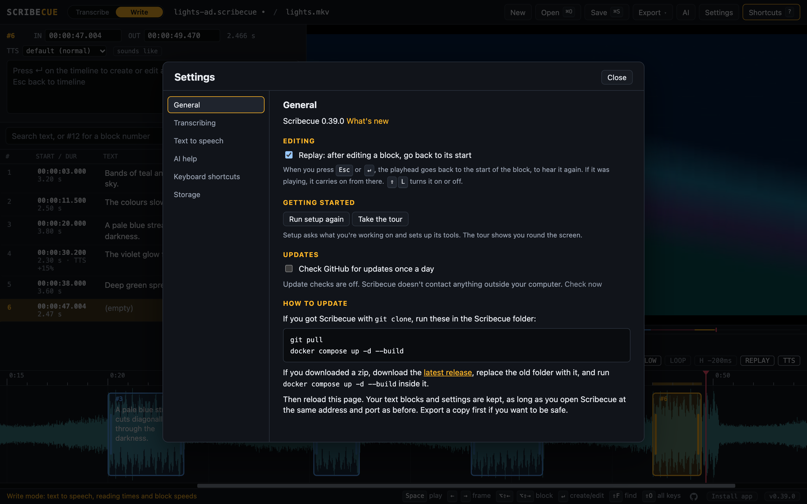

# Getting started

How Scribecue is laid out, the loop you work in, and how to save, export and get around.

## Modes: Transcribe and Write

The switch next to the Scribecue name picks what you're doing, and shows only the features
for it. Your choice is remembered. The setup that opens the first time you use Scribecue
asks this too, along with the tools for that mode and whether to check for updates.
**Run setup again**, in **Settings** under **General**, runs it again. Nothing changes until
you press **Finish**.

**Settings**, at the top (`Alt+Shift+S`), has everything you set up rather than use while
you work, in sections: **General** (Replay, setup and the tour, and update checks in the
Docker version), **Transcribing** (the reaction offset and speech to text), **Text to
speech**, **AI help** (your provider, and a TMDB key for looking up the cast), **Keyboard
shortcuts**, and **Storage**. Settings that are on show under the video, such as `REPLAY`,
`STT` or `TTS`, and clicking one opens its section.

| | Transcribe | Write |
| --- | --- | --- |
| For | Existing audio description, at its original timing | New audio description |
| [Hold-to-mark](TRANSCRIBING.md#marking-lines-with-h) (`H`, `Shift+H`) | ✓ | Times your own read of the selected block |
| [Speech to text](TRANSCRIBING.md#speech-to-text-with-whisper) (`Alt+Shift+T`, `Alt+Shift+H`) | ✓ | |
| [Text to speech](WRITING.md) (`V`, `Shift+V`, `[` `]`, reading times, block speeds) | | ✓ |
| Everything else | ✓ | ✓ |

Switching only hides features. Block speeds and settings are kept for when you switch
back. Pressing a key from the other mode tells you which mode it's in.

## Basic workflows

Most of the work is one short loop, repeated for every line. Learn the few keys in it and
you'll rarely need anything else. Press `?` at any time to see every shortcut.

### The writing loop

For new audio description, in **Write** mode with text to speech on (`Alt+Shift+V`, or
**Settings**). Open the video with `Ctrl/Cmd+Shift+O`, then repeat:

1. **Find a gap.** Play until there's room for a description, and stop there.
   - `Space` plays or pauses.
   - `←` `→` move one frame, to get the exact spot.
2. **Write the description.**
   - `Enter` makes a block at the playhead and opens it for typing.
   - Type the line. Its end follows how long the reading takes, and the reading time turns
     red if the line doesn't fit before the next block.
   - `Esc` closes the block.
3. **Listen to it.**
   - `V` reads the block aloud with the video.
   - `[` `]` make this block's reading slower or faster.

Then carry on playing to the next gap.

**Reading it yourself instead,** with text to speech off or on: select the block and
**hold `H`**. It plays from the block's start while you read the line aloud, and when you
let go, the block ends there, moved back by the reaction offset (`Shift+H` changes it).
It works like punching in on a recording, from wherever the playhead is in the block:

- **Need a breath?** Let go at a comfortable point, then hold `H` again to carry on from
  there. The pause doesn't count, so the block is as long as your reading.
- **Fluffed a word?** Step back with `←` `→` to just before it and hold `H` to redo the
  rest from there.
- **To start over,** press `G` to go to the block's start, then hold `H`.

`Ctrl/Cmd+Z` undoes one part at a time.

### The transcribing loop

For existing audio description, in **Transcribe** mode. Open the video with
`Ctrl/Cmd+Shift+O`. If it has a description track and you don't hear it, press `T` to
switch tracks. Then repeat:

1. **Play to the next line.**
   - `Space` plays or pauses.
2. **Mark it.**
   - Hold `H` while the narrator speaks, and let go when they stop. Playback pauses, and a
     block opens for typing.
3. **Type it.**
   - Type the line.
   - `Enter` or `Esc` closes the block, and playback carries on.

To hear a block again while you type, press `L`. It loops until you close the block.

With [speech to text](TRANSCRIBING.md#speech-to-text-with-whisper) on, step 3 is checking: the line is typed for you a
moment after you let go of `H`. [TRANSCRIBING.md](TRANSCRIBING.md) covers transcribing in
full.

### Saving

**Save your work as a project** with `Ctrl/Cmd+S`. A project (`.scribecue`) keeps
everything: the blocks, each block's text to speech speed and whether its end follows the
reading, the mode and its settings, where you were, and which video it belongs to. Keep
one per programme, and open any of them with `Ctrl/Cmd+O`.

- The first save asks where to put the file. After that, `Ctrl/Cmd+S` saves straight back
  to it, even after a reload. `Ctrl/Cmd+Shift+S` saves a copy under a new name.
- **Autosave:** once a project has a file, Scribecue saves your changes to it a couple of
  seconds after you stop, and **autosaved** shows next to the project name. After a reload,
  or when you open a project, the browser asks before Scribecue may save to the file again;
  until you allow it, the status says **autosave paused**, and clicking it (or `Ctrl/Cmd+S`)
  carries on. Autosave is always on. The file always holds your latest changes, so keep a
  copy with `Ctrl/Cmd+Shift+S` before a big change if you might want the old version.
- A dot after the project name at the top, such as `lights-ad.scribecue •`, means there
  are changes you haven't saved yet. After 20 minutes of unsaved work, a note reminds you
  to save, since until then the work is only kept in the browser. **Later** asks again in
  half an hour.
- **The video comes back with the project.** In Chrome and Edge, Scribecue remembers each
  video you open, so opening a project, or Scribecue again, reopens its video too. After a
  restart the browser asks first: click **Reopen** with the video's name, where the video
  goes. If the video has moved, open it again with `Ctrl/Cmd+Shift+O`. Other browsers can't
  keep a link to a file, so there you open the video yourself. **Open** (`Ctrl/Cmd+O`)
  takes projects, scripts and video or audio files alike, and you can pick the project and
  its video together. Scribecue warns you if you pick a different video from the project's.
- **New**, at the top left, starts again, and offers two ways to do it:
  - **Clear the blocks** removes every block and keeps the video, the project file and your
    notes, ready to write from scratch on the same video. To swap in a different script
    instead, you don't need this: opening a script (`Ctrl/Cmd+O`) replaces the blocks
    and keeps the video.
  - **New project** also closes the video and clears your notes, for different work.

  `Ctrl/Cmd+Z` brings the blocks back either way, though after a new project you'd open the
  video again.

Saving in place and autosave need Chrome or Edge. Other browsers download a copy of the
project each time you save.

**Export** when the script is finished, or to hand it to someone who doesn't use
Scribecue, such as another writer or a QC reviewer. The **Export** menu at the top has:

- **Script as SRT** (`Ctrl/Cmd+E`).
- **Script as WebVTT** (`Ctrl/Cmd+Shift+E`), which also keeps each block's text to speech
  speed, voice and sounds-like words.
- **Description track (WAV)**, in Write mode with a [Piper](VOICES.md#piper-voices), [Kokoro](VOICES.md#kokoro-voices) or [Google](VOICES.md#google-cloud-voices) voice: the
  readings as one audio file. It's also in the text to speech settings.

`Ctrl/Cmd+O` also opens SRT and VTT files, and Frazier's `.adc` scripts, with their
timings, block speeds and voices, base speed, and the pronunciations marked in them, which become
sounds-like words. Your work in progress is saved in the browser as you go too, so
reloading the page doesn't lose anything.

### Getting around

| To | Press |
| --- | --- |
| Play or pause | `Space` |
| Move one frame back or forward | `←` `→` |
| Move 3 seconds back or forward | `Shift+←` `Shift+→` |
| Go back to the start of the block you're in, or on to the next one | `Alt+Shift+←` `Alt+Shift+→`. At a block's start, `Alt+Shift+←` goes to the previous block; while playing, pressing it twice quickly does the same |
| Step through the list | `↑` `↓`, from the selected block |
| Go to the start or end of the selected block | `G` / `Shift+G` |
| Go to the beginning or end of the video | `Home` / `End` (`Fn+←` / `Fn+→` on Mac laptops) |
| Go to a time | `Alt+Shift+J`, then type it, such as `1:23.5` |
| Go anywhere | Click the timeline, or drag along the time ruler above it |
| Jump around the whole video | Click or drag the scrubber bar under the video. It stays a thin line until you point at it. Blocks show as marks along it, the selected one highlighted, and hovering shows the time |

### Adjusting timing

| To | Press |
| --- | --- |
| Set the block's start or end to the playhead | `A` / `S` |
| Move the start or end by 100 ms | `Q` `W` / `E` `R` (with `Shift`: 10 ms) |
| Move the whole block by 100 ms | `,` `.` (with `Shift`: 10 ms) |
| Set the end to where the reading finishes (Write) | `Shift+V` |
| Drag a block, or its edges | Mouse, on the timeline |

## Files with several audio tracks

When a file has more than one audio track, such as the original mix and an audio
description mix, an **Audio** picker appears under the video. Press `T` / `Shift+T` to switch
tracks. The waveform always shows the track you're hearing.

A track marked as audio description is picked automatically. Scribecue looks for
Matroska's visually-impaired flag, an MP4 `kind` box, or a name containing "description",
"AD" or "narration".

How track switching works

Chrome and Firefox can only play a video's default audio track. So Scribecue copies the
chosen track out, without re-encoding, into an audio-only file in memory, and plays it in
step with the muted video. Each track is copied once per session, so switching back
afterwards is instant. Safari switches tracks itself.

## Other handy features

- **Editing in the list:** as in Frazier, the selected block opens in its place in the list,
  with its start and end, its text and, with text to speech on, its speed, voice and reading
  time. The buttons after the times move it back one frame, to start at the playhead, or
  forward one frame. The × deletes it.
- **Blocks ahead:** the selected block, or the one playing, moves to the top of the list,
  so the blocks coming up show below it. A block you click stays where it is.
- **Search:** the box above the list filters blocks by text, or by number with `#12`.
  Press `/` to jump to it. `Shift+F` opens quick navigation, and `Alt+Shift+J` jumps to a timecode.
- **Find and replace:** **Replace…** next to the search box, or `Alt+Shift+F`, changes text
  in every block at once, such as a character's name. Tick **Match case** to only change
  it written exactly that way, and **Whole words only** to leave longer words alone (Tom,
  but not Tomorrow). **Find next** steps through the blocks it's in, and one `Ctrl/Cmd+Z`
  undoes **Replace all**.
- **Player controls:** the buttons under the video step to the previous or next block,
  jump 3 seconds or one frame, play or pause, play just the selected block, and loop the
  block under the playhead. Hover over one to see its key.
- **SMPTE timecode:** times show as `hh:mm:ss:ff`, in frames of the video, at its own
  frame rate, read from the file or measured as it plays (25 until then). 29.97 and
  59.94 fps videos use drop-frame timecode, `hh:mm:ss;ff`, which keeps to the clock. You
  can type a block's start and end as timecode or as `hh:mm:ss.mmm`. Exported SRT and WebVTT files
  keep their usual milliseconds. `←` `→` step one frame of the video.
- **Copy a timecode:** click the clock under the video. To set a block's start or end to
  the playhead, press `A` or `S`.
- **Swap sides:** the ⇄ button at the top puts the video on the left and the editor and
  block list on the right, or back again. Scribecue remembers which you chose.
- **Time remaining:** click the total length, next to the clock, to show the time left
  instead. Click it again to go back. Scribecue remembers which you chose.
- **Mouse:** drag a block to move it, drag an edge to resize it (in Write mode with text
  to speech on, a block's length comes from its reading instead), or drag across empty
  space to draw a new block. Scroll to pan, and `Ctrl/Cmd`+scroll or pinch to zoom.
- **Guided tour:** lights up each part of the editor in turn and explains it, from the two
  modes to text to speech, AI help and privacy. It opens on your first visit, before the
  setup, and **Take the tour** in the shortcuts overlay (`?`) shows it again.
- **The loop to work in:** once setup is done, a card shows the loop for the mode you
  picked (see [Basic workflows](#basic-workflows)), and the first time you switch to the
  other mode, its loop shows too. **Show the loop** in the shortcuts overlay brings it back. `→` and `←` step through it, and
  `Esc` ends it.
- **What's new:** after Scribecue updates, a window lists everything that changed since the
  version you were on. In the web version, click the version number in the bottom right to
  see the current release's notes again.
- **Guides:** **Guides** in the shortcuts overlay (`?`) opens this README, the
  [transcribing guide](TRANSCRIBING.md), the [AI guide](AI.md), the [Google voices guide](GOOGLE-VOICES.md) and [INSTALL.md](INSTALL.md)
  inside Scribecue, and links to them anywhere in Scribecue open there too.
- **Screen readers:** Scribecue's messages are read out as they appear, with key symbols
  said as words. The block list is a list a screen reader can move through, reading each
  block's number, start, length and text, and which one is selected. The buttons and
  indicators under the video say what they do, and whether they're on. Lines too long to
  read in time say so in words, not only in red, and so do blocks whose reading is made. The timeline itself is hidden from screen
  readers, since the block list has the same blocks. Work on screen readers is still going:
  with NVDA or JAWS on Windows, single-letter keys such as `H` may need focus mode.
- **Scribecue on GitHub:** the small GitHub mark in the bottom right opens the project's
  page, with the source, releases and a place to report problems.

## Supported files

| | Supported |
| --- | --- |
| **Projects** | Scribecue projects (`.scribecue`), to open and save |
| **Scripts** | SRT and WebVTT, to open and to export; Frazier's `.adc`, to open |
| **Video and audio** | MP4, MOV, M4A, MKV, WebM and WAV, with AAC, Opus, Vorbis, FLAC, MP3 or PCM audio |
| **Very large files** | Fine: the waveform is built by streaming the file from disk, and fills in as it goes |
| **Other formats** | The whole file is decoded in memory, so they need to be under 2 GB |
| **AC-3, E-AC-3, DTS, TrueHD** | Play, but with no waveform, because browsers can't decode them |

When switching audio tracks, Vorbis tracks show a waveform but can't be played on their own.
