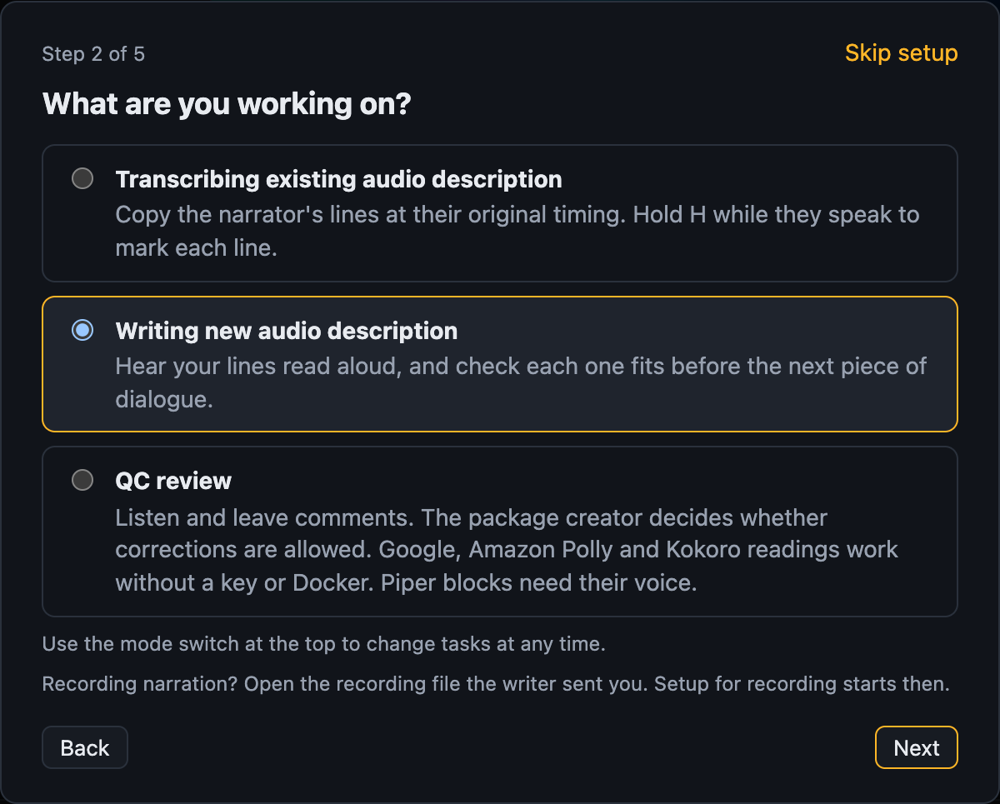
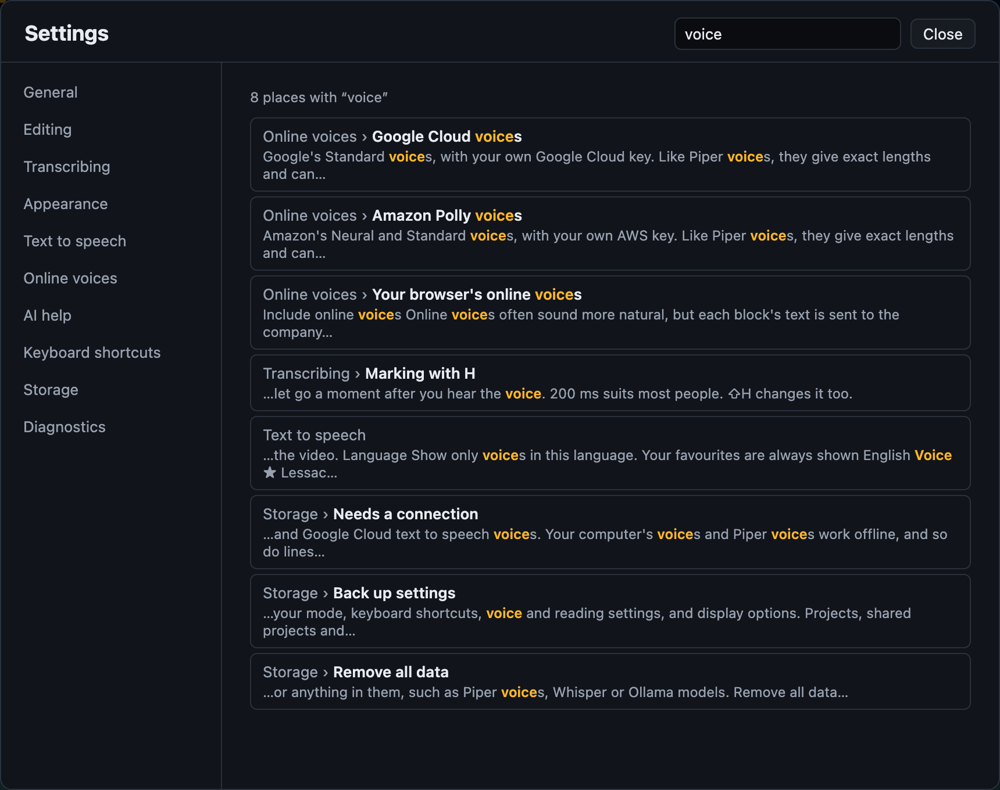
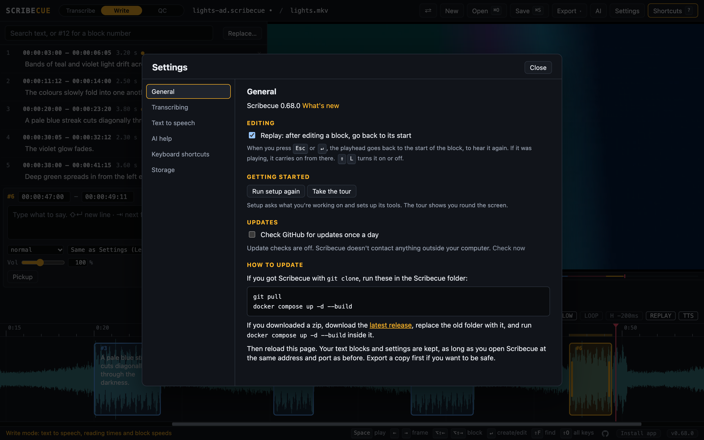
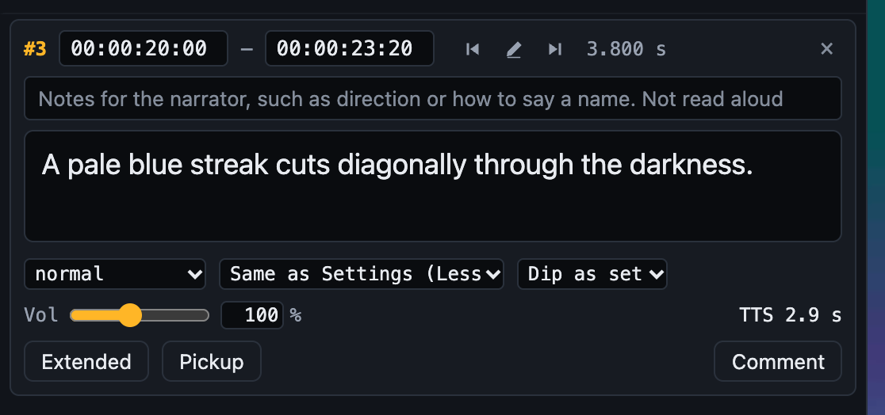
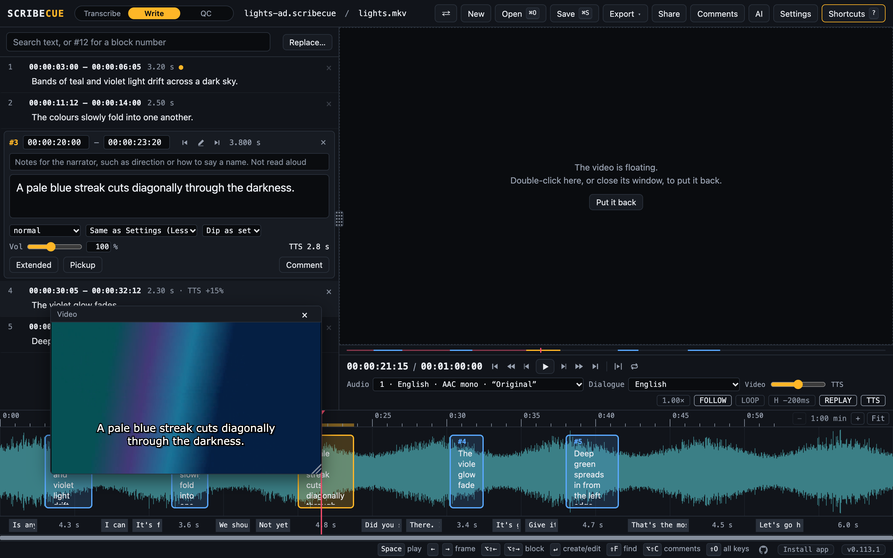
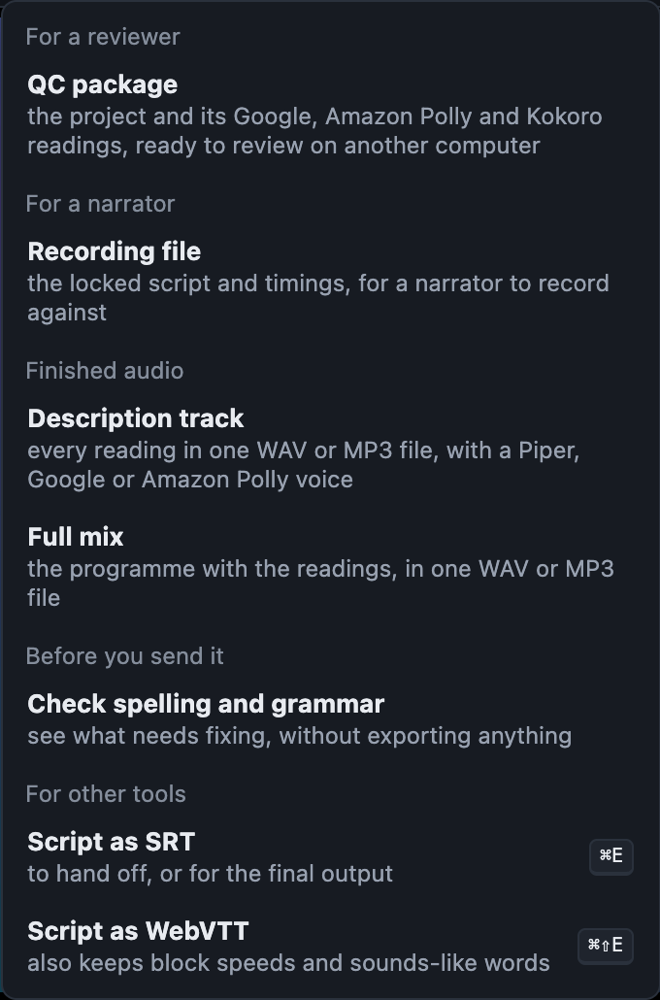
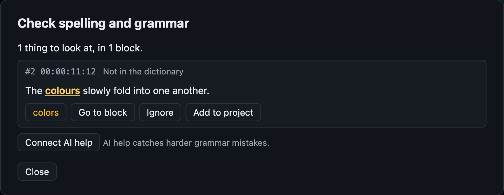
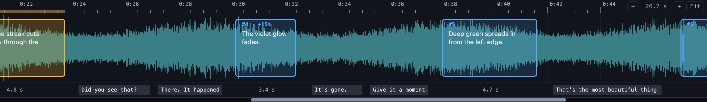

# Getting started

How Scribecue is laid out, the loop you work in, and how to save and export.

## Modes

The switch next to Scribecue’s name chooses what you’re doing.

| Mode | Use it for |
| --- | --- |
| **Transcribe** | Time existing narration with H. Whisper can type it for you. |
| **Write** | Write descriptions and hear them with text to speech. |
| **QC** | Review scripts; the package creator decides whether edits are allowed. Listen to original readings or programme sound, and leave comments. |

Switching keeps your work. QC follows the package’s saved editing permission. Comments work in Write and QC.

The first time you use a mode, a short setup for it opens. That includes opening a file that switches modes, such as a QC package or a recording file. You can skip it.


[The QC guide](QC.md) explains voice checks and portable review packages.

## Settings

**Settings**, at the top (`Alt+Shift+S`), has everything you set up rather than use while
you work. It's in sections down the left:

| Section | What's in it |
|---|---|
| **General** | Your name, setup and the tour, updates |
| **Editing** | Replay, Lead-in, spelling and grammar, and Return to start in Record mode |
| **Transcribing** | Marking with `H`, speech to text |
| **Appearance** | Highlight colour, text over the video, text size, floating video |
| **Text to speech** | Voices, reading aloud, timings, audio exports |
| **Online voices** | Google Cloud and Amazon Polly keys, and the browser's online voices |
| **AI help** | Your AI provider, and a TMDB key for the cast |
| **Keyboard shortcuts** | Changing your keys |
| **Storage** | What's kept in this browser, and backing up your settings |
| **Diagnostics** | Details to send with a problem report |

To find a setting, type in **Search settings** at the top (`Ctrl/Cmd+F`). Press `Enter`
for the first result, or click one to go to it.



Settings that are on show under the video, such as `REPLAY` or `STT`. Click one to open its
section. `TTS` is different: clicking it turns text to speech off or on for the open project.

**Run setup again**, under **General**, asks the first-time questions again. In Record mode, it sets up recording.
Nothing changes until you press **Finish**.

**Your name**, under **General**, is optional. It goes on your comments and on the blocks you change.
Once someone else has changed blocks too, an open block shows who changed it last.

**Appearance** changes how Scribecue looks in this browser. The first setup asks about it too:

| Setting | What it changes |
|---|---|
| **Highlight colour** | Buttons and switches that are on, the mode switch, and the chosen block |
| **Text over the video** | The style, size, background and position of the block shown over the picture |
| **Text size** | The blocks in the list and the block editor |
| **Floating video** | Whether the video floats in this tab or in its own window |

For the text over the video, **Burnt in** looks as it does in a video with subtitles. Its size
and background are set, so those rows are greyed out. Pick **Classic** for the look from before
0.114.0, with the size and background you choose. For its dark box too, pick a **Dark** background.

**Reset to defaults** undoes them all.

**Back up settings**, under **Storage**, saves your settings to a file. Import it in another
browser to set it up the same way. Projects aren't in the file. API keys are only in it if
you turn on **Include API keys** when exporting.



## The loop

Most of the work is one short loop, repeated for every line. Press `?` at any time to see
every shortcut.

### The writing loop

In **Write** mode, with text to speech on (`Alt+Shift+V`). Open the video with
`Ctrl/Cmd+Shift+O`, then repeat:

1. **Find a gap.** Press `Space` to play, and again to stop where there's room. `←` `→`
   move one frame.
2. **Write.** Press `Enter` to make a block at the playhead, and type the line. Its end
   follows how long the reading takes. The reading time turns red if it doesn't fit before
   the next block.
3. **Close it.** Press `Esc` or `Enter`.
4. **Listen.** Press `V` to hear it with the video. `[` `]` make this block's reading
   slower or faster. To hear the moments before it too, set a **Lead-in** in Settings,
   under Editing.

**To read it yourself instead,** turn text to speech off for the project (click `TTS`
under the video). Then select the block and hold `H` while you say the line. When you let
go, the block ends there.

- **Need a breath?** Let go, then hold `H` again to carry on.
- **Fluffed a word?** Step back with `←` to just before it, and hold `H` to redo the rest.
- **Start over:** press `G` to go to the block's start, then hold `H`.

### The transcribing loop

In **Transcribe** mode. Open the video with `Ctrl/Cmd+Shift+O`. Press `T` to switch to
the description track. Then repeat:

1. **Play** to the next line with `Space`.
2. **Mark it.** Hold `H` while the narrator speaks, and let go when they stop. A block
   opens for typing.
3. **Type it,** then press `Enter` or `Esc`. Playback carries on.

Press `L` to hear the block again while you type.

With [speech to text](TRANSCRIBING.md#speech-to-text-with-whisper) on, the line is typed
for you, so step 3 is just checking it. [Transcribing](TRANSCRIBING.md) has the details.

### The recording loop

In **Record** mode, for a narrator. Open the recording file and the video together, then
select the first block and repeat:

1. **Record it.** Press `Enter` or `R`. The video plays from a few seconds before the
   block. Read when the picture reaches the line, then press `Enter` or `Space` to stop.
2. **Tidy it.** Press `S` to trim the silence off both ends of the take and start it at
   the block. Not happy? Press `Enter` again for a new take.
3. **Go on** to the next block with `Alt+Shift+→`.

**Only the end went wrong?** [Punch in](RECORDING.md#punching-in): press `E` to put the
playhead at the end of the take, step back with `←` to where to pick up, then press
`Shift+Enter`.

[Recording narration](RECORDING.md) has the details.

## Editing a block

Click a block in the list to open it. The playhead stays where it is while you edit.

`Esc` or `Enter` closes the block and moves the playhead to it. The block stays selected.



The open block shows its start and end, its text and, with text to speech on, its speed,
voice and reading time. The buttons after the times move it:

- back one frame;
- to start at the playhead;
- forward one frame.

The × deletes it.

**Notes** sit above the text. Use them to tell the narrator something, such as how to say
a name. Text to speech doesn't read them, and they don't change the block's timing. Blocks
with notes show `notes` in the list.

| To | Press |
| --- | --- |
| Set the start or end to the playhead | `A` / `S` |
| Move the start or end by 100 ms | `Q` `W` / `E` `R` (add `Shift` for 10 ms) |
| Move the whole block by 100 ms | `,` `.` (add `Shift` for 10 ms) |
| Set the end to where the reading finishes (Write) | `Shift+V` |

On the timeline, drag a block to move it, drag an edge to change its start or end, or drag
across empty space to draw a new block.

## Getting around

| To | Press |
| --- | --- |
| Play or pause | `Space` |
| Move one frame | `←` `→` |
| Move 3 seconds | `Shift+←` `Shift+→` |
| Go to the previous or next block | `Alt+Shift+←` `Alt+Shift+→` |
| Step through the list | `↑` `↓` |
| Go to the start or end of the selected block | `G` / `Shift+G` |
| Go to the beginning or end of the video | `Home` / `End` (`Fn+←` / `Fn+→` on Mac laptops) |
| Go to a time | `Alt+Shift+J` |
| Search the blocks | `/` |

You can also click the timeline, or the bar under the video, to jump anywhere. Scroll the
timeline to pan.

To zoom, use − and + at the top right of the timeline, `Ctrl/Cmd`+scroll, or pinch.
**Fit** shows the whole programme. Zoomed right in, the waveform shows each sound
sharply, down to a few milliseconds.

## Floating the video

Double-click the video to float it in a window of its own. Every key still works.



- **Move it:** drag the picture, or its top bar. A click still plays or pauses.
- **Resize it:** drag any corner. The text over the video grows and shrinks with the picture.
- **Pick a size:** right-click it for 0.25×, 0.5×, 2× or 3× the video's own size, or
  **Original size**. Sizes that don't fit are greyed out. **Full screen** and **Center** are
  there too.
- **Put it back:** double-click it, close it, or double-click the spot it left.
- **On another screen:** set **Floating video** to **In its own window**, under
  **Appearance** in Settings. This needs Chrome or Edge. Other browsers float it in the tab.

## Saving

Press `Ctrl/Cmd+S` to save a **project** (`.scribecue`). It keeps everything: the blocks,
their speeds, comments, your settings, where you were and which video goes with it. Keep one per
programme. `Ctrl/Cmd+O` opens it again.

- **Autosave:** once a project has a file, your changes are saved to it a couple of
  seconds after you stop. If it says **autosave paused**, click it to let Scribecue save
  again.
- **A dot after the project name** means there are changes you haven't saved.
- **Save a copy** with `Ctrl/Cmd+Shift+S`, for example before a big change.
- **Open several files at once** by dragging them onto Scribecue together, such as a
  project and its video.
- **The video reopens with the project.** If you're asked, click **Reopen**. If the video
  has moved, open it again with `Ctrl/Cmd+Shift+O`.
- **New**, at the top left, either clears the blocks and keeps the video, or starts a
  whole new project. `Ctrl/Cmd+Z` brings the blocks back.

Saving to the file, autosave and reopening the video need Chrome or Edge. Other browsers
download a copy each time you save, and you open the video yourself.

## Comments

Comments work in Write and QC, so you can leave notes on your own script.

- **On a block:** click **Comment** in the open block.
- **At the playhead:** click **Comments** at the top.
- **At a time:** right-click the timeline.

Add your name if you like, write the comment, then click **Post comment**. Comments save
with the project or QC package.

The [QC guide](QC.md) covers reviewing, resolving comments and returning the project.

## Exporting

When the script is finished, or to share it with someone who doesn't use Scribecue,
use the **Export** menu at the top:



- **Script as SRT** (`Ctrl/Cmd+E`).
- **Script as WebVTT** (`Ctrl/Cmd+Shift+E`). This also keeps each block's speed, voice and
  sounds-like words.
- **Description track:** all the readings as one WAV or MP3 file, in Write mode with a
  [Piper](VOICES.md#piper-voices), [Kokoro](VOICES.md#kokoro-voices), [Google](VOICES.md#google-cloud-voices)
  or [Amazon Polly](VOICES.md#amazon-polly-voices) voice.
- **Full mix:** the programme's sound with the readings, the programme lowered under each
  one, as one WAV or MP3 file. See [Exporting the full mix](WRITING.md#exporting-the-full-mix).
- **DAW markers:** a WAV to record and place lines in another program. See below.
- **Video with subtitles:** a copy of the video, as an MP4, with the script and the
  timecode on the picture. The script looks as it does over the video in Scribecue. Pick
  a resolution: Original, 480p, 720p or 1080p. Only those smaller than the video show. This
  needs [ffmpeg in Docker](INSTALL.md#the-full-mix-in-the-video-ffmpeg). Without it, you
  get the script and an ffmpeg command to run yourself.

### DAW markers

The WAV plays a tone while each block lasts, and is silent between them. Drop it at the
start of a project in your DAW, and each block's text names its place.

| Blocks as | What you get | Works in |
| --- | --- | --- |
| **Markers** | A marker at each block's start | Logic Pro |
| **Regions** | A region from each block's start to its end | Reaper |

`Ctrl/Cmd+O` opens SRT and WebVTT scripts too, and Frazier's `.adc` scripts.

## Checking spelling and grammar

Scribecue checks the script when you export it, as a file, a package or audio. If something
looks wrong, it lists it first. Fix it, or choose **Export anyway**.

To check without exporting, choose **Export → Check spelling and grammar**, or press
`Alt+Shift+K`.



| Button | What it does |
| --- | --- |
| A suggestion | Changes the text. A misspelled word changes everywhere it's used. `Ctrl/Cmd+Z` undoes it. |
| **Go to block** | Closes the list and selects the block. |
| **Ignore** | Hides it until you open another project. |
| **Add to project** | Accepts a name or term. It's saved with the project. |

- **Names:** capitalised words in your [AI notes](AI.md#what-it-does) and words with a
  sounds-like count as right.
- **Exporting again:** you're only asked about new problems.
- **Harder mistakes:** the check works offline, but it only catches simple grammar.
  [Check grammar with AI](AI.md#what-it-does) goes further.
- **In QC mode:** it lists problems but can't change text. Go to the block to comment.
- **Settings:** under Editing, turn off **Check before exporting**, or choose American,
  British or Canadian spelling. The check is English only, so turn it off for other languages.

## Which file to send

Your project is your master copy, so keep it. The other files are made for one person and one job.

| Sending to | Send | Make it with |
| --- | --- | --- |
| A reviewer, for a text to speech review | [QC package](QC.md#make-a-portable-qc-package) (`.scribecueqc`) | **Export → QC package** |
| A reviewer, for a recorded mix | Project (`.scribecue`) and a review mix | `Ctrl/Cmd+S` |
| The writer, after a review | The package or project you were sent, saved with your review | `Ctrl/Cmd+S` |
| A narrator | [Recording file](RECORDING.md#making-the-recording-file) (`.scribecuerec`) | **Export → Recording file** |
| Your other computer, partway through recording | [Session package](RECORDING.md#moving-to-another-computer) (`.scribesession`) | **Export → Session package** |
| A mixer | [Narration WAV](RECORDING.md#exporting-the-narration), or a Narration zip with alts | **Export**, in Record mode |
| Someone using another tool | SRT or WebVTT | **Export** |

- **Send the video too.** Reviewers and narrators need their own copy. No Scribecue file contains it.
- **Narrating your own script?** Export a recording file, then open it. Record mode opens from that file.

## See the dialogue on the timeline

If a video has subtitles, a **dialogue lane** appears under the blocks. It shows when people
speak and how long each gap is, so you can see where description fits.



| To do this | Do this |
| --- | --- |
| Jump to the next or previous free gap | Press `D` or `Shift+D` |
| Fill the gap with a new block | Press `Shift+N`, or double-click the gap |
| Jump to a block over dialogue | Press `U` or `Shift+U` |
| Move the playhead | Click the lane |
| Pick other subtitles, or turn the lane off | Use **Dialogue** under the video |
| Use a subtitle file (SRT or WebVTT) | Pick **Load a subtitle file…** in **Dialogue** |

- **A free gap has room for a block.** `D` skips gaps that are already filled, and
  stretches under 1.5 seconds.
- **`Shift+N` starts at the playhead.** If you've just pressed `D`, that's the start of the gap.
- **Over dialogue is a warning, not an error.** A block over dialogue has a yellow line
  under it on the timeline. The list and editor say so too. With text to speech on, this
  goes by the reading, not the block's length. It shows in Write and QC.
- **Timing is close, not exact.** Subtitles often stay up a little after the words end.
  Check with the waveform.
- **An MKV's subtitles can take a while the first time.** They load while the video is
  paused, so it plays smoothly. After that they show straight away.
- **Sound notes don't count as speech,** such as `[door slams]`.
- **Picture subtitles can't be read.** Blu-ray and DVD subtitles are images. They show in
  the list, greyed out. Load a subtitle file instead.
- **The lane stays in this browser.** It isn't part of your script, project or exports.

## Files with several audio tracks

If a file has more than one audio track, such as the original mix and a description mix,
an **Audio** picker appears under the video. The file's default track plays first.
`T` / `Shift+T` switch tracks.

The first time you use a track, the video goes silent until **Getting the sound ready**
finishes. After that, switching to it is instant until you close the video.

## Other handy features

- **Timecode:** times show as `hh:mm:ss:ff`, in frames at the video's own frame rate.
  29.97 and 59.94 fps videos use drop-frame timecode (`hh:mm:ss;ff`). Exported scripts
  use the usual milliseconds.
- **Waveforms are kept** in your browser, so reopening a video, even after a reload, shows
  its waveform straight away. The 20 used most recently are kept.
- **A new video's waveform builds as you work.** It slows down while the video plays, and
  waits while you jump, so the video comes first.
- **Copy a timecode:** click the clock under the video.
- **Time remaining:** click the total length, next to the clock.
- **Find and replace:** `Alt+Shift+F`, or **Replace…** next to the search box, changes text
  in every block at once, such as a character's name.
- **Quick navigation:** `Shift+F`.
- **Swap sides:** the ⇄ button at the top puts the video on the other side.
- **Resize the video:** drag the bar between the list and the video. Drag it to the edge
  to hide the list, and double-click it to go back to the usual width. Typing in a block or
  pressing `/` brings a hidden list back. With the Burnt in style, the text over the video keeps
  its size against the picture.
- **Player controls:** the buttons under the video. Hover over one to see its key.
- **The tour and the loop:** **Take the tour** and **Show the loop**, in the shortcuts
  overlay (`?`), show them again.
- **What's new:** after an update, a window lists what changed. In the web version, click
  the version number in the bottom right to see it again.
- **Screen readers:** messages are read out as they appear, and the block list can be read
  block by block. With NVDA or JAWS, single-letter keys such as `H` may need focus mode.
  This is still being worked on.

## What your computer needs

| | Enough | Better |
|---|---|---|
| **Computer** | A laptop or desktop from about 2016 on, with a keyboard | Anything from the last few years |
| **Memory** | 4 GB | 8 GB, for Piper voices or speech to text in the browser |
| **Browser** | Chrome or Edge, kept up to date | |

Phones and tablets aren't supported. Running Scribecue yourself with Docker needs a little
more: see [what you need](INSTALL.md#what-you-need).

## On a slower computer

If the video is slow to start or to jump, or stutters:

- **Use a smaller copy of the video to write with,** such as 720p instead of 1080p or 4K.
  The timings are the same, so the script works with the full-size video too.
- **Use Chrome or Edge.** Chromium, especially on Linux, often can't use the computer's
  graphics chip to play video, and some builds [can't play MP4](#if-a-video-wont-play).
- **Prefer a file with only the description mix,** if you have one. With several audio
  tracks, Scribecue plays the chosen track alongside the video, which is more work.
- **Press play once.** **Loading…** next to the clock means it's getting ready.
  **Seeking…** means it's finding the place you jumped to.
- **Still slow?** [Report it](TROUBLESHOOTING.md#reporting-a-problem) with the diagnostics
  from Settings. They show how playback is going on your computer.

## Supported files

| | Supported |
| --- | --- |
| **Projects** | `.scribecue` and `.scribecueqc`, to open and save |
| **Recording** | `.scribecuerec` and `.scribesession`, to open |
| **Scripts** | SRT and WebVTT, to open and export; Frazier's `.adc`, to open |
| **Video and audio** | MP4, MOV, M4A, MKV, WebM and WAV |
| **TS, M2TS, AVI, WMV, MPG** | Browsers can't open these. See [If a video won't play](#if-a-video-wont-play) |
| **Very large files** | Fine for MP4, MOV, M4A, MKV, WebM and WAV. Other formats need to be under 2 GB |
| **AC-3, E-AC-3 audio** | Work, after a short wait the first time. See [If a video has no sound](#if-a-video-has-no-sound) |
| **DTS, TrueHD audio** | The picture plays with no sound or waveform. See [If a video has no sound](#if-a-video-has-no-sound) |

### If a video won't play

Some builds of Chromium, mostly on Linux, can't play H.264 video or AAC sound, which most
MP4 files use. Scribecue tells you when it starts, and again when you open a file it
can't play.

- **Use Chrome or Edge,** which play them.
- **Or open a WebM copy,** which every browser plays. If you run Scribecue with
  [ffmpeg in Docker](INSTALL.md#the-full-mix-in-the-video-ffmpeg), choose
  **Make a copy that plays** and Scribecue makes one, opens it and downloads it for you.
- **Keep the copy with the project.** Your timings work with the original video too.

**TS, M2TS, AVI, WMV, MPG:** browsers can't open these, so changing browser won't help. TV
recordings are often like this. Make an MP4 copy with [ffmpeg](https://ffmpeg.org/):

```bash
ffmpeg -i "Film.m2ts" -map 0:v:0 -map 0:a:0 -c:v copy -c:a aac -b:a 192k -movflags +faststart "Film.mp4"
```

- This keeps the picture as it is, and the first audio track.
- If the copy shows no picture, change `-c:v copy` to `-c:v libx264`. It takes longer.

### If a video has no sound

**After switching tracks, or with AC-3 and E-AC-3:** wait for **Getting the sound ready**
over the video to finish. It can
take a few minutes for a long film.

Scribecue keeps AC-3 and E-AC-3 sound for the last three videos, so they open straight away
next time.

**DTS and TrueHD:** most browsers can't play these. Scribecue tells you when you open a file
like this.

- **With [ffmpeg in Docker](INSTALL.md#the-full-mix-in-the-video-ffmpeg),** choose **Make a
  copy that plays**. The picture stays as it is.
- **Otherwise,** open a copy with AAC sound.

### If the picture freezes

If the picture sticks or flashes green while the sound carries on, the graphics chip or its
driver is probably failing to play the video. Jumps can also take many seconds. It's most
likely on Linux.

Turn off the graphics chip for video:

1. Open `chrome://flags` in Chrome, Edge or Chromium.
2. Find **Hardware-accelerated video decode** and set it to **Disabled**.
3. Click **Relaunch**, then try the same place in the video.

To try it once first, start the browser from a terminal with
`--disable-accelerated-video-decode`.

Still happening? Play the same place in VLC. If it's wrong there too, the file may be damaged.
