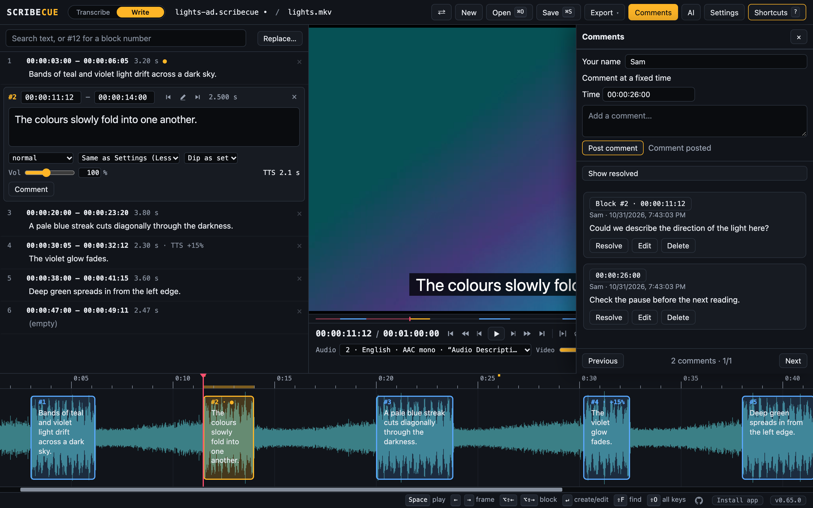

# QC review

Review an audio description script or a finished programme, leave comments, and return
one project with your findings. You don't need an AI provider or a paid voice to comment.

## Contents

- [Prepare the handoff](#prepare-the-handoff)
- [Open a review copy](#open-a-review-copy)
- [Choose what you hear](#choose-what-you-hear)
- [Work through the programme](#work-through-the-programme)
- [Add useful comments](#add-useful-comments)
- [Check fixes and resolve comments](#check-fixes-and-resolve-comments)
- [Save and return the review](#save-and-return-the-review)
- [QC keys](#qc-keys)
- [Common problems](#common-problems)

## Prepare the handoff

Ask the person sending the review for:

- **The `.scribecue` project.** It keeps the blocks, their timings, comments and reading settings.
- **The matching video or audio.** The project refers to it; it doesn't contain the media.
  Check the cut, lead-in and duration match the writer's copy.
- **The review brief.** Agree whether you should comment only or make fixes. Confirm the
  audience, house style, deadline and who signs off the result.
- **A review mix, for recorded audio QC.** Ask for a video with the narration and programme
  sound together. A text-to-speech preview won't tell you how the recorded narrator sounds.

Use a current version of Scribecue on both computers so both can read and save comments.

For several reviewers, name each copy and agree who combines the findings. Scribecue
uses file handoffs. It has no live shared review or automatic merge of project copies.

## Open a review copy

1. Use Chrome or Edge on a computer. Open Scribecue and follow setup if it's your first visit.
2. Press `Ctrl/Cmd+O` and open the project. Open its media with `Ctrl/Cmd+Shift+O`.
   If **Reopen** is offered for the right video, you can use that instead.
3. Save a separate copy with `Ctrl/Cmd+Shift+S` before making changes. For example,
   `episode-03-qc-sam-round1.scribecue`. If your browser downloads a copy, rename that file.
4. Check a familiar scene near the beginning and another later on. Make sure the blocks
   line up with the same picture and sound throughout.

Comments work in **Write** and **Transcribe**. There is no separate QC mode or script lock
for a project: typing in a block or dragging it can change the script or its timing.
If the brief is comments only, use the Comment button and leave the block fields alone.

A recording file (`.scribecuerec`) opens in **Record** mode, where Comments aren't available.
Click **Leave**, then open the `.scribecue` project for review. Ask for that project if
it wasn't supplied. [Recording narration](RECORDING.md) explains the recording workflow.

## Choose what you hear

| Reviewing | Setup |
| --- | --- |
| A script before recording | Use **Write**. Open **Settings → Text to speech** (`Alt+Shift+V`) and choose a voice. |
| Recorded description in the video | Use **Transcribe** to hear the file without extra text-to-speech readings. Choose its description mix in **Audio** under the video. |
| The description against the original sound | Switch tracks with `T` or `Shift+T`, or use **Audio**. Check which track you're listening to before judging a problem. |

For script previews, the **Video / TTS** slider balances the readings against the video.
Check the voice and base speed against the brief. A different voice can take a different
amount of time to read the same words. [Writing](WRITING.md#hearing-it-while-you-play)
covers readings, levels and dips.

A red reading time means the preview doesn't fit its block. A `~` means the length is
still an estimate. Listen to the whole gap, including the dialogue after it. Synthetic
speech helps check pacing; it doesn't approve the final narrator's delivery or mix.

### Checking a narration WAV

With the script open, open a narration WAV exported by Scribecue. Scribecue compares the
script and timings stored with the recording against the project you have open. It lists
differences and says if the recording file was changed outside Scribecue.

This comparison doesn't check the words actually spoken, pronunciation or sound quality.
Opening that WAV runs the comparison rather than playing it against the video. For a
listening pass with comments, ask for the review video with narration mixed in.
See [Checking the narration](RECORDING.md#checking-the-narration).

## Work through the programme

Play a scene before judging individual blocks, then return to anything that needs a
closer listen. Read each block alongside the picture and sound.

| Check | Questions to ask |
| --- | --- |
| Meaning | Does the description match what's visible? Is an action, character or change of place missing or misleading? |
| Clarity | Can a listener follow who is doing what? Are names, terms and pronouns consistent? |
| Information | Does it add useful visual information? Does it repeat something already clear from the sound, or reveal something before the programme does? |
| Timing | Does it fit around dialogue, lyrics and sounds the audience needs? Does the description arrive at the right point in the action? |
| Pacing | Is there enough room to understand the words? Does the scene need more breathing space? |
| Delivery and mix | In recorded audio, are names said correctly? Are words missing, repeated or cut off? Is the narration clear against the programme, without distracting level changes or noise? |

Use the agreed brief to judge wording, detail and style. Separate an error from a
preference so the writer knows which changes matter.

- **Replay a block:** select it and press `Shift+Space`. For context, start a few seconds
  before it and listen past its end as well.
- **Loop:** press `L` to repeat a block. Turn looping off before continuing through the programme.
- **Find a point:** click the time ruler, step with `←` or `→`, or press `Alt+Shift+J`
  to type a time. `/` searches block text; type `#12` to find block 12.
- **Keep up:** `F` turns Follow on or off. When it's on, the selected block changes as
  playback reaches each one. Pause before composing a block comment and check its target.

Typing a comment uses the normal typing keys. `Space` inserts a space there. Use the
play/pause control under the video, or close the drawer with `Esc` before using playback
shortcuts. Finish with a pass at normal speed, even if you slowed down difficult sections.

## Add useful comments

### On a block

1. Pause and click the block to open it.
2. Click **Comment** beneath its text. The drawer names the block and its start time.
3. Enter **Your name** if you want it on the comment.
4. Write the comment and click **Post comment**. Repeat for separate issues.

The name is remembered in this browser after you post. Each comment keeps the name used
when it was posted; changing the field affects future comments. A blank name displays
as **Reviewer**. Names are labels, not verified accounts.

### At a time on the timeline

Right-click the point you want to comment on. Or put the playhead there, then open
**Comments** at the top (`Alt+Shift+C`). The **Time** field can be changed before posting.
It accepts a timecode such as `00:00:23:12`, or seconds.

Use a timeline comment for a missing block, a sound or picture problem, or an observation
about a whole scene. The comment marks one point. If it concerns a range, write the start
and end in the text.

### Make the next action clear

Say what's wrong, why it matters and what should be checked or changed. Put one issue in
each comment so it can be resolved on its own. For example:

- **Timing:** “The last two words cover the next speaker. Could this end before the reply?”
- **Wording:** “She passes the key to Mara, rather than taking it. Please check the action.”
- **Retake:** “The narrator says ‘Marla’ here. The character is Mara.”
- **Scene note:** “From 00:04:12:00 to 00:04:20:00, check whether the footsteps already make the movement clear.”

If you propose replacement wording, say it's a suggestion. To answer a note, add another
comment on the same block or time and identify the issue you're answering.

### How comments behave

- Click a comment's **block or time** to jump there. Comments are ordered by their position
  in the programme. Use **Previous** and **Next** for further pages.
- A block comment follows the block when its timing changes. A timeline comment keeps its
  fixed time. Neither follows a new picture edit automatically.
- Splitting leaves comments on the first half. Merging keeps both blocks' comments.
  Deleting a block deletes its comments too, so check them before removing it.
- **Edit** changes the text; click **Save** when done. **Delete** removes the comment.
  Anyone with the project can edit or delete its comments, including another reviewer's.
- To undo a posted comment change, close the drawer with `Esc`, then press `Ctrl/Cmd+Z`.
  Inside a text box, that shortcut undoes typing instead.

## Check fixes and resolve comments

1. Open the revised project with the matching media.
2. Click each comment's block or time and check the change in context.
3. Click **Resolve** only when the issue is dealt with. It stays in the project but is
   hidden from the normal list.
4. Turn on **Show resolved** to see open and resolved comments together. Use **Reopen**
   if the issue remains or a later change brings it back.

Don't delete a note just because you've read it. Resolve keeps its text, reviewer name
and original posting time available for the next person. It isn't a formal sign-off.
Agree who resolves issues and who approves the finished programme.

## Save and return the review

1. Press `Ctrl/Cmd+S`. Check the project no longer has an unsaved-changes dot beside its name.
   If it says **autosave paused**, click it to allow saving, or save a new copy.
2. Send the reviewed `.scribecue` file. Include changed media only if you've agreed to
   supply it. Comments aren't included in SRT, WebVTT, recording files or audio exports.
3. Say which source project and picture cut you reviewed. State whether you changed
   the script or timings, and whether any checks remain unfinished.

Chrome and Edge can save back to a chosen file. Other browsers download a copy on each
save; return the newest download. Browser recovery alone doesn't give the next person a file.
[Saving](GETTING-STARTED.md#saving) has the details.

For several reviewers, keep the returned files separate until the review owner has
combined the findings. Opening another project replaces the current one; it doesn't add
its comments to the project already open. Keep the earlier round until the next one is agreed.

Files and comments stay on your computer until you share them. A person receiving a
project can read its resolved comments and any saved programme notes too. Online voices
send text to their provider, and AI help can send text and frames when you use it. Follow
the programme's sharing rules; use local voices when needed. [Privacy](../README.md#privacy)
explains what each optional service sends.

## QC keys

These are the default keys when you're outside a text field. `Ctrl/Cmd` means Ctrl on
Windows and Linux, and Cmd on Mac. Alt is Option on Mac. For custom layouts and keys
while typing, see [Keyboard shortcuts](SHORTCUTS.md).

| Key | Action |
| --- | --- |
| `Ctrl/Cmd+O` | Open a project or script |
| `Ctrl/Cmd+Shift+O` | Open video or audio |
| `Ctrl/Cmd+Shift+S` | Save a separate project copy |
| `Ctrl/Cmd+S` | Save the review |
| `Space` | Play or pause |
| `Shift+Space` | Play the selected block once |
| `L` | Loop a block |
| `↑` / `↓` | Select the previous / next block |
| `←` / `→` | Move one frame back / forward |
| `Shift+←` / `Shift+→` | Move three seconds back / forward |
| `Alt+Shift+J` | Jump to a time |
| `/` | Search block text or a block number |
| `T` / `Shift+T` | Next / previous audio track |
| `Alt+Shift+C` | Open or close Comments |
| `Esc` | Close the Comments drawer |
| `\` | Reset playback speed to 1× |
| `?` | Show all shortcuts |

## Common problems

| Problem | What to do |
| --- | --- |
| No Comment button | Open a block. If you're in Record mode, leave it and open the project. Update Scribecue if Comments is missing. |
| The note is on the wrong target | Check the target above the comment box. Use the block's Comment button for a block, or right-click the timeline for a time. Delete and repost a misplaced note. |
| Two voices speak at once | You're hearing text to speech over a recorded description mix. Use Transcribe, turn text to speech off, or choose the original soundtrack for a script preview. |
| No narration | Check Audio, the volume and the selected track. For a script preview, check text to speech is on in Write mode. |
| “No open comments” | Try Show resolved. Also check you're opening the returned project, rather than the original file or an SRT export. |
| All notes don't fit in the drawer | Scroll its comment list and use Previous / Next for further pages. |
| Timing differs between copies | Confirm the picture cut and lead-in. For synthetic speech, check the voice and base speed too. |
| Narration “matches”, but sounds wrong | The WAV comparison checks the saved script and timings. Listen to the actual recording to check delivery and the mix. |

If you are also making fixes, [Writing](WRITING.md) covers reading speeds and timings;
[Transcribing](TRANSCRIBING.md#checking-and-fixing) covers checking recorded description.
