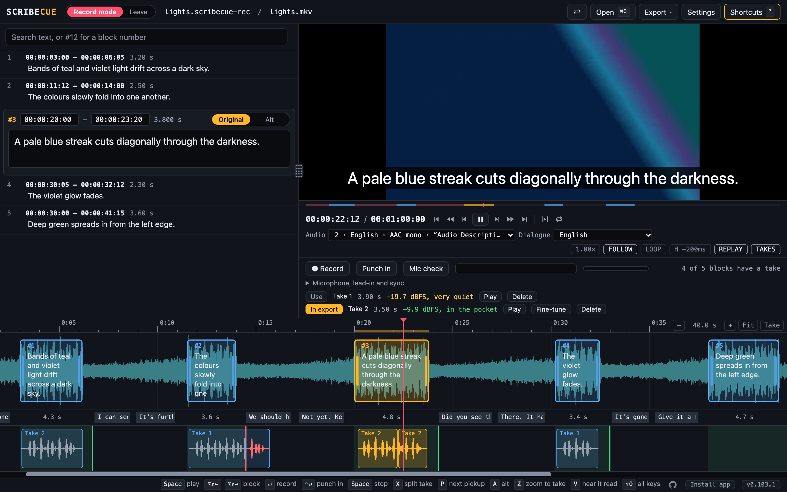
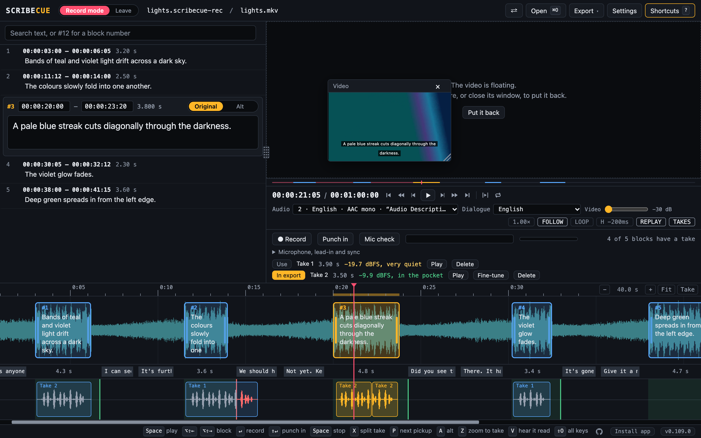
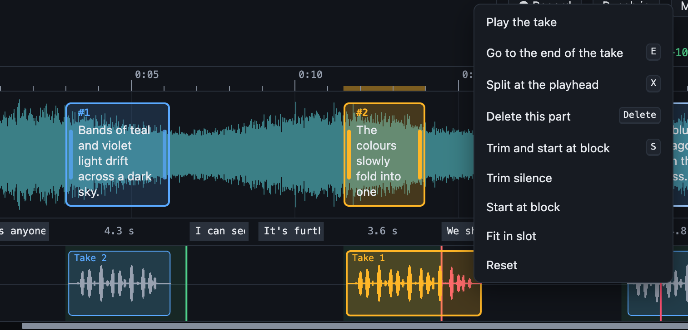
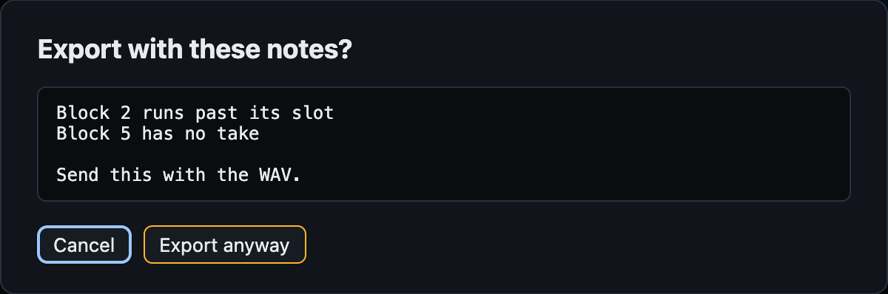
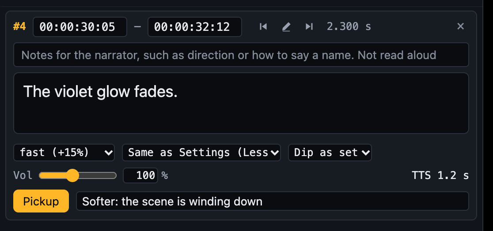
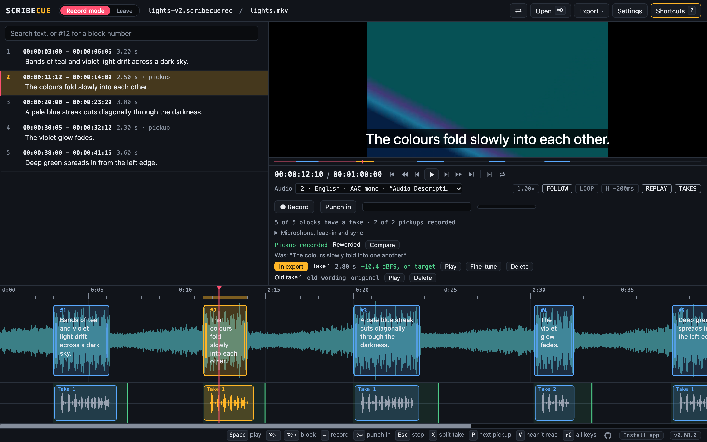
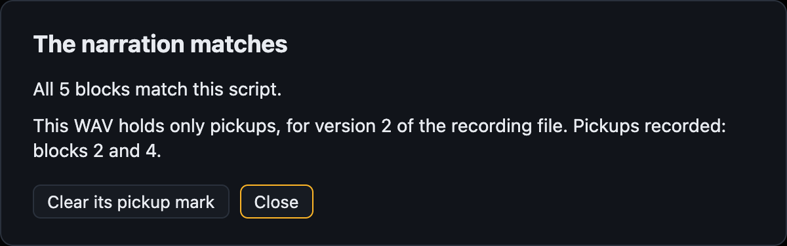
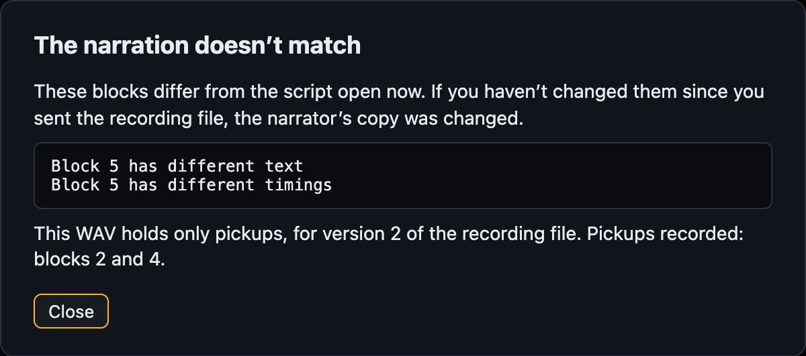

# Recording narration

A narrator can record your script in Scribecue, block by block, against the video. The
mixer gets one WAV file that lands at the right timecode by itself.

The narrator can't change the script or the timings. Nothing is processed: the takes are
raw, for the mixer to work with.

## Contents

- [How it works](#how-it-works)
- [Making the recording file](#making-the-recording-file)
- [Recording](#recording)
  - [Before you start](#before-you-start)
  - [Recording a block](#recording-a-block)
  - [Extended blocks](#extended-blocks)
  - [Levels](#levels)
  - [Takes](#takes)
  - [Punching in](#punching-in)
  - [Editing a take](#editing-a-take)
  - [Keeping takes in sync](#keeping-takes-in-sync)
  - [Exporting the narration](#exporting-the-narration)
- [Pickups](#pickups)
- [Alts](#alts)
- [For the mixer](#for-the-mixer)
- [Checking the narration](#checking-the-narration)
  - [An extended video for the narration](#an-extended-video-for-the-narration)
- [Where takes are kept](#where-takes-are-kept)

## How it works

1. **You** export a recording file from your finished script.
2. **You** send the narrator the recording file and a copy of the video.
3. **The narrator** opens both in Scribecue and records each block.
4. **The narrator** exports the narration WAV and sends it to the mixer. With
   [alts](#alts), it's a zip.
5. **The mixer** imports it into their DAW.
6. **You** can open the WAV or zip in Scribecue to [check it](#checking-the-narration).
7. **For a fix,** you send a new version of the recording file, and the narrator records
   only the [pickups](#pickups).

## Making the recording file

1. Open the script and its video in Write mode.
2. Choose **Export → Recording file**.
3. Type the timecode of the video's first frame, such as `01:00:00:00`.
4. Pick the **Grace after each block**: how far a take may run past its block. See [slots](#recording).
5. Click **Save the file**.

Open the video first, so Scribecue can check the narrator has the same copy.

[Extended blocks](WRITING.md#extended-ad) go in the file, and the narrator reads them with the
video stopped. See [Extended blocks](#extended-blocks).

## Recording

### Before you start

- **Open the recording file and the video.** Drag both onto Scribecue together.
  Scribecue opens in Record mode. Reloading the page keeps you there.
- **Choose where to keep the takes.** Scribecue asks the first time. See
  [Where takes are kept](#where-takes-are-kept).
- **Leave** closes the recording, and the script with it. Your takes are kept: open the
  recording file again to carry on.
- **Use wired headphones.** You don't hear yourself through Scribecue: use your audio
  interface for that.
- **Set the video's sound** with **Video** under the video, from 0 dB (as it is) down to
  −30 dB. It starts at −30 dB. Double-click it to go back there.
- **Follow the setup.** The first time you open a recording file, it helps you pick your
  microphone, set your [level](#levels) and choose a lead-in: 3 to 5 seconds of video
  before each block.
- **Change them later** under **Microphone, lead-in and sync**.
- **Put the picture where you read.** Double-click the video to float it. Drag it next to
  the script, or make it bigger. With **In its own window** set under **Appearance**, it can
  go on another screen (Chrome and Edge). Every key still works. See
  [Floating the video](GETTING-STARTED.md#floating-the-video).

  
- **Set your interface to 48 kHz** if you can. Scribecue tells you if it's converting.
- **Use Chrome, Edge, Firefox or Safari.**
- **Return to start**, under **Settings → Editing**, puts the playhead back where you
  started playing when you stop. It's off at first. `RETURN` shows under the video while
  it's on.

### Recording a block

1. Select the block. It opens in the list, locked.
2. Press Enter or R. Allow the microphone the first time.
3. The video plays from the lead-in, with the takes before it. Set your gain on the meter while it does.
4. Read the line when the picture reaches it. The bar shows how much of the slot is left.
5. Press Enter, R or Space to stop. The take is saved straight away. Esc stops, discards it, and puts the playhead back.

The writer's notes for a block, such as how to say a name, show above its text.

| Key | Does |
|---|---|
| Enter or R | Record the selected block, or stop |
| Shift+Enter or Shift+R | [Punch in](#punching-in) from the playhead |
| E / Shift+E | Playhead to the end of the next or previous part of the block's take |
| X | Split the block's take at the playhead |
| S | [Trim the silence](#editing-a-take) off the block's take and start it at the block |
| Delete | Delete the part of a take you last clicked |
| Ctrl/Cmd+Z | Bring back the take you deleted or discarded |
| Esc | Stop recording, and discard the take |
| V | Hear the block read by text to speech, as a guide |
| P | Go to the next [pickup](#pickups) |
| A | Switch to the block's [alt](#alts), or back |
| Z | [Zoom to the block's take](#editing-a-take), or back |
| Space | Play or pause, or stop recording |
| Alt+Shift+Left / Right | Previous or next block |

A block's **slot** runs from its start to the end of its grace. The writer picks the grace in the
recording file, from none to 2 seconds. It's half a second unless they change it. A slot never runs into the
next block. A take that runs past it isn't cut off. It's marked in red until you [trim or move it](#editing-a-take).

### Extended blocks

An extended block has no time limit. The video stops at its start, and you read at your own pace.

1. Press `Enter` or `R`, as for any block.
2. Read when the video stops.
3. Press `Enter` or `Space` when you've finished.

- When you play, the video stops for each extended take while it plays. Press `Space` to skip the rest.
- Punching in doesn't work on an extended block. Record it again instead.
- On the timeline, the take can run under the blocks after it. Those blocks aren't affected.

### Levels

Aim for each take's loudest moment to land in the pocket: −12 to −6 dBFS. Never go over −6.

| Peak | Means |
|---|---|
| −12 to −6 dBFS | In the pocket |
| −16 to −12 dBFS | Fine, for a quieter delivery |
| Below −16 dBFS | Very quiet: the export mentions it |
| Above −6 dBFS | Too loud: retake it, or the export won't go ahead |

**Mic check**, under the video, opens a tall meter with the pocket marked. Read a few
lines, including your loudest, and set your gain so the peaks land in it.

### Takes

- Every take is kept, under the video in Record mode.
- The take picked for each block shows on the timeline, under the video's waveform.
- The take you're recording grows there as you read, with its waveform.
- **While the video plays,** you hear the take picked for each block, where it was read.
  The lead-in plays them too, so you can match what came before.
  Click **TAKES** under the video to turn that off.
- **The selected block stays selected** as the video plays. **FOLLOW** only keeps the
  playhead in view.
- **Play** plays one take against the video.
- **Use** picks the take for the export. A new take is picked automatically.
- **Fine-tune** moves, trims or splits the take in the export by the millisecond.
- **Delete** removes a take. Press Ctrl/Cmd+Z, or click the message, to bring it back.
  Once you close the recording, it's gone.

### Punching in

Punch in to redo the end of a take, or to finish one you stopped early.

1. Put the playhead where you want to pick up. Press E to jump to the end of the take, or
   of each part in turn, or right-click the take and choose **Go to the end of the take**. Step back
   with the arrow keys if you need to.
2. Press Shift+Enter or Shift+R, or click **Punch in**.
3. The lead-in plays the takes before it, then this take up to the playhead. Read on from there.

The result is a new take: the old one up to the playhead, then the new reading. The old
take is kept, so **Use** brings it back.

### Editing a take

The picked takes show as clips on the timeline, in a track under the video's waveform.
Each block's slot is shaded green. Any part of a take past its slot is red.

To place a take precisely, press Z, or click **Take** at the top right of the timeline. The
block's slot and take fill the timeline. Press Z again to zoom back. Zoomed in, the take's
waveform and the video's are sharp enough to line up single sounds.

| To | Do |
|---|---|
| Move a take, or one part of it | Drag the clip |
| Trim it | Drag either end in |
| Split it | Put the playhead in it, then press X |
| Delete a part | Click it, then press Delete |
| Play it against the video | Double-click it |
| Cut the silence and start it at the block | Select its block, then press S |
| Trim silence, start at block, fit in slot or reset | Right-click it |

- Dragged edges snap to the block's start, the slot's end, the playhead and the other parts.
- **Trim silence** cuts the quiet off both ends of every part. A click on its own goes too, such as the key you stopped with.
- **Start at block** moves the take so its sound starts where the block does.
- **Trim and start at block** does both, in that order. S does the same.
- **Fit in slot** trims the end to where the slot stops.
- **Reset** brings back the take as recorded, deleted parts too.
- **Fine-tune** in the list does the same by the millisecond, from the keyboard.

To fix a late start, press S. To choose where the sound begins yourself, drag the take's
start in, then use **Start at block**.

To close up a pause, split the take in it, use **Trim silence**, then drag the second
part back. Parts can't overlap.

The recording itself isn't changed, so nothing is lost:

- To bring back sound you trimmed, split off or deleted, drag the end of the part beside it back out.
- It stops at the next part, or at the start or end of the recording.
- In **Fine-tune**, a trim below 0 does the same.

### Keeping takes in sync

With wired headphones, Scribecue keeps takes in sync by itself.

Bluetooth headphones delay what you hear, often by 150 to 300 ms. Scribecue warns when
your headphones look like Bluetooth. If you have to use them:

1. Open **Microphone, lead-in and sync** and click **Sync test**.
2. Raise or lower **Sync** until the flash and the beep happen together.

Play a take back to check it sits where you read it.

### Exporting the narration

Choose **Export → Narration WAV**. With [alts](#alts) recorded, it's **Narration
zip** instead.

- Any take above −6 dBFS stops the export, alts included. Scribecue lists the blocks to
  retake.
- Blocks with no take, takes that run long, and quiet takes don't stop it. Scribecue lists
  them: send that list with the WAV. A zip has it inside.

## Pickups

A pickup is a block the narrator records again, such as a misread name or a reworded
line. Takes carry over from one version of the recording file to the next, so only the
pickups need recording.

### Asking for pickups

1. In Write mode, select a block and click **Pickup**. Add a note, such as how to say a
   name.
2. Reword any lines that need it. They're asked for anyway.
3. Choose **Export → Recording file** again. Scribecue says which version it is, and
   which blocks it asks for.

Export from the same script you sent before, so Scribecue knows what changed.

### Recording pickups

- Open the new recording file. Takes of unchanged lines are already in place, even if
  the line has moved.
- The count under the video says how many pickups are recorded.
- A pickup block shows its note, or the wording it replaces.
- Press P to go to the next pickup.
- Takes of a reworded line show as **Old take**. You can play them, but they can't go
  into the export.
- The take you had before the pickup is labelled **original**.
- **Compare** plays the original, then the pickup, each against the video.

Then choose **Export → Pickups WAV**. It holds only the new takes, as long as the
programme, so each one drops into place. Its markers carry the notes.

Started recording before Scribecue 0.68.0? Those takes stay with the old recording
file. To bring them in, open the new file, then click **Bring in takes from an older
recording file** under **Microphone, lead-in and sync**. Choose the old file.

## Alts

An alt is your own wording for a block, recorded beside the script's, such as "toward"
for "towards". The block and its takes stay as they are.

1. Select the block and press `A`, or click **Alt** in the open block.
2. Change the wording in the block's text box, then press `Enter`.
3. Press `Enter` or `R` to record it.
4. Press `A` to go back to the original.

- With Alt on, the video shows the alt's wording. Its takes are dashed on the timeline.
- The alt keeps the block's slot. The block doesn't get longer.
- A block has one alt, with takes of its own. **In export** picks one, as for the block.

With an alt recorded, **Export → Narration zip** saves:

| File | Holds |
| --- | --- |
| `…-narration.wav` | The narration, as without alts |
| `…-alts.wav` | Only the alts, as long as the programme |
| `…-notes.txt` | Each alt's wording, and the notes for the mixer |

## For the mixer

The narration is one Broadcast WAV file:

- Mono, 48 kHz, 24-bit, as long as the programme.
- Silent apart from the takes, each where it was read.
- Timestamped with the programme's start. In Pro Tools, use **Spot to original time
  stamp**.
- Marked at each block, with its number and first words, for DAWs that read markers,
  such as Reaper and Nuendo.

With extended blocks, the WAV is longer than the programme. Each take sits where the video
stops for it, for as long as the narrator read. A pause list comes with it, as a CSV. A
pickup of an extended block can change the pauses after it, so export the narration again.

Mix against a video that stops for the narrator's pauses, not the writer's text to speech
ones. To make it, see [An extended video for the narration](#an-extended-video-for-the-narration).

A pickups WAV is the same, with only the pickups in it. Put it on its own track over the
first narration, and mute the old takes under it. Its markers say `PICKUP`, with the
note.

An alts WAV is the same, with only the alts in it. Put it on its own track. To use an
alt, mute the narration under it. Its markers say `ALT`, with the wording.

## Checking the narration

The recording file is plain text, so a narrator could change it in a text editor. You
can't stop that, but Scribecue shows it.

1. Open your script.
2. Open the narration WAV or zip, as you'd open a video.

Scribecue lists any block whose text or timing differs from yours. It also says if the
recording file was changed by hand. Blocks you've changed since sending the file show up
too.

For a pickups WAV, it also says which pickups were recorded and which are still to do.
A button there clears the **Pickup** marks of the blocks that are done.

With alts, it lists each one. In Write mode, **Use** makes an alt the block's text. The
block keeps its timing, since the alt was read in its slot.

### An extended video for the narration

With extended blocks, a narrator's reads rarely take as long as the text to speech did. A
video made in Write mode would stop for the wrong lengths. Make one from the narration
instead:

1. Open the script and the programme's video.
2. Open the full narration WAV or zip. The check opens.
3. Click **Export extended video**.

The picture stops for each of the narrator's pauses, so the narration lines up with it.

| Option | Does |
|---|---|
| **Include the narration** | On: the narration is mixed in. Off: the programme's sound alone, to mix in an editor. |
| **Export pause list** | Saves a CSV of where the video stops and for how long, for other editors. |

- It needs ffmpeg, as Write mode's extended video does. Without it, you get the audio and a command to run.
- A progress bar shows under the header. **Stop** there cancels it.
- WAVs exported before Scribecue 0.87 don't keep their pauses. Export the narration again from Record mode.
- Pickups and alts WAVs don't offer it. Use the full narration.

## Where takes are kept

The first time you open a recording, Scribecue asks where to keep its takes. A minute of
takes uses about 8.6 MB.

| Choice | What happens |
|---|---|
| **Choose folder…** | Each take is saved there as you record it. Chrome and Edge only. |
| **Keep in this browser** | Only this browser has them. Clearing its data for Scribecue deletes them. |

- **Pick an empty folder,** or one of your own: Scribecue makes a folder for the takes
  inside it.
- **After a reload,** the browser asks again before Scribecue may use the folder. Click
  **Resume in** and the folder's name, under the video.
- **Chose the browser?** Click **Move takes to a folder…** under **Microphone, lead-in and
  sync**. New takes are saved there too.
- **New versions** of the recording file use the same folder.
- **Takes from earlier versions** of Scribecue, kept in the browser, move into the folder
  you choose.

### Moving to another computer

1. Choose **Export → Session package**. It's one file with the script and the takes.
2. Choose **Every take**, or **Chosen takes only** for a smaller file. That keeps the takes
   in the export, and the take each pickup replaced.
3. Open it in Scribecue on the other computer.
4. Choose a folder for the takes.

Or copy the folder. Then open the recording file on the other computer, and choose the
copied folder.

### Deleting takes

- **In a folder,** the takes are your own files. Delete the folder when you're done.
- **In the browser,** click **Delete all** next to **Recorded takes** in **Settings →
  Offline and storage**. It deletes them from every recording.

Export any narration you still need first.
