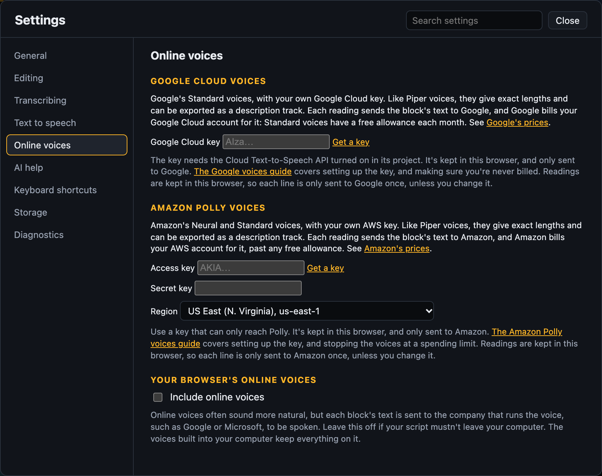

# Voices

The voices Scribecue can read with, and how to add more natural ones.

| Voice | Sounds | Stays on your computer | Exact lengths and audio export | Where |
| --- | --- | --- | --- | --- |
| [Your computer's voices](#voices-on-your-computer) | Basic | ✓ | | Everywhere |
| [Piper](#piper-voices) (recommended) | Natural | ✓ | ✓ | Web version and Docker |
| [Kokoro](#kokoro-voices) | Most lifelike | ✓ | ✓ | Docker only |
| [Google Cloud](#google-cloud-voices) | Natural | Sent to Google | ✓ | Web version and Docker, with your own key |
| [Amazon Polly](#amazon-polly-voices) | Natural | Sent to Amazon | ✓ | Web version and Docker, with your own key |
| [Online voices](#online-voices) | Natural | Sent to the voice's company | | Mainly Edge and Chrome |

Choose a voice in **Settings → Text to speech** (`Alt+Shift+V`).

## Voices on your computer

Scribecue uses the voices built into your computer to start with. To add more, then reload
Scribecue:

- **Mac:** System Settings → Accessibility → Spoken Content. Click ⓘ next to **System
  voice** to download more voices.
- **Windows:** Settings → Time & language → Speech, then **Add voices**.
- **Linux:** install speech-dispatcher and a voice such as espeak-ng from your
  distribution's packages.

These voices can only be heard, not recorded, so they can't be exported as an audio file.

On a Mac, browsers only offer the standard voices. Enhanced and Premium voices, such as
Samantha (Enhanced), don't show up in Safari, Chrome or other browsers. For a natural
voice, use [Piper](#piper-voices) or [Kokoro](#kokoro-voices).

## Online voices

Tick **Include online voices** in **Settings → Online voices**. They often sound more
natural, but each block's text is sent to the company that runs the voice, such as Google
or Microsoft, and they need the internet. Edge has dozens, Chrome a few, and Safari and
Firefox none.

## Piper voices

[Piper](https://github.com/OHF-Voice/piper1-gpl) is an open-source speech engine with
natural-sounding voices. It's the one we recommend: your script never leaves your
computer, and it works offline.

- **Lengths are exact straight away,** and each line always takes the same time.
- **You can export a description track:** every reading as one audio file, ready to mix
  with the programme. It's in the **Export** menu. Choose WAV or MP3 under **Save as**
  in the text to speech settings. An MP3 is much smaller, about 43 MB an hour at 96 kbps
  against 160 MB for a WAV. For the final mix, a WAV keeps full quality.

There are four English voices. Click one to hear it: [Lessac](../docs/voices/lessac.mp3)
and [Ryan](../docs/voices/ryan.mp3) (US), and [Alba](../docs/voices/alba.mp3) and
[Alan](../docs/voices/alan.mp3) (UK).

### In the web version

1. Open the text to speech settings and turn text to speech on.
2. Under **Natural voices**, pick a voice and click **Download**.

The first voice is about 100 MB, and each one after that about 63 MB. Setup can download
one for you too. To free the space, pick the voice and click **Remove**.

### With Docker

Piper can run in a container next to Scribecue, which reads a little faster. See
[Natural-sounding voices](INSTALL.md#natural-sounding-voices-piper).

## Kokoro voices

[Kokoro](https://huggingface.co/hexgrad/Kokoro-82M) voices sound closer to a person
reading than Piper's. There are 41 voices in US and UK English, Spanish, French, Hindi,
Italian and Brazilian Portuguese. They stay on your computer, work offline, and do
everything Piper's do.

Hear a few: [Heart](../docs/voices/kokoro-heart.mp3) and
[Liam](../docs/voices/kokoro-liam.mp3) (US), and [Alice](../docs/voices/kokoro-alice.mp3)
and [Lewis](../docs/voices/kokoro-lewis.mp3) (UK).

Kokoro needs Docker, because its voices are too big to run well in a browser. See
[More lifelike voices](INSTALL.md#more-lifelike-voices-kokoro).

## Google Cloud voices

Google Cloud's **Standard** voices work with your own Google Cloud key. Like Piper, their
lengths are exact and you can export a description track. Unlike Piper, each reading
sends the block's text to Google, and they need the internet.

[Google voices](GOOGLE-VOICES.md) walks you through getting a key and making sure you're
never billed. Then paste the key under **Google Cloud voices** in **Settings → Online
voices**. **Forget** removes it.

Each line is only sent to Google once, unless you change it. Readings are kept in your
browser, so playing, reopening and exporting cost nothing. While you're typing, nothing is
sent: the block is read when you close it.

## Amazon Polly voices

Polly's **Neural** and **Standard** voices work with your own AWS key. They work like
Google Cloud voices: lengths are exact, you can export a description track, and each
reading sends the block's text to Amazon.

[Amazon Polly voices](POLLY-VOICES.md) walks you through getting a key and setting a
spending limit. Then paste it under **Amazon Polly voices** in **Settings → Online voices**.

## Good to know

- **If a project's voice isn't available,** such as a Piper voice while Piper isn't
  running, Scribecue says which voice is reading instead. The project keeps its own voice
  for when it's back.
- **Description tracks** are levelled: every reading comes out at the same level, unless
  you've changed a block's volume. The [full mix](WRITING.md#exporting-the-full-mix)
  keeps each voice's own level instead, as you hear it when playing.

## Voices on another computer

A plain project keeps voice choices, not the voices or their audio. Another voice can
take a different time to read the same words. Missing voices open a project in QC
with its saved timings fixed. An approximate preview must be chosen explicitly.

For accurate TTS review, send a [QC package](QC.md#make-a-portable-qc-package).
It keeps the Google Cloud, Amazon Polly and Kokoro readings, so the reviewer needs no key or Docker.
The reviewer's computer reads Piper blocks, with the same voice. For built-in voices,
supply a recorded review mix instead.
