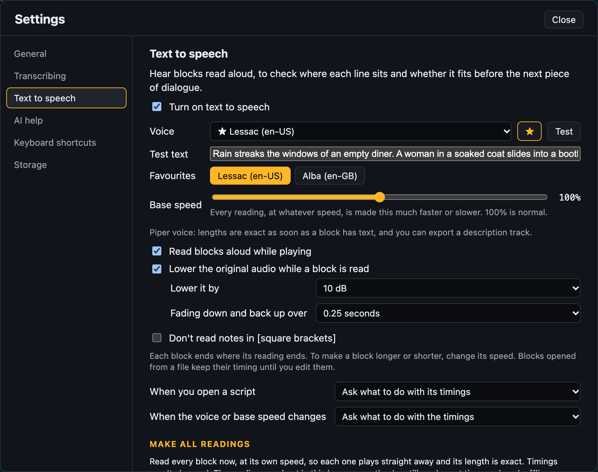
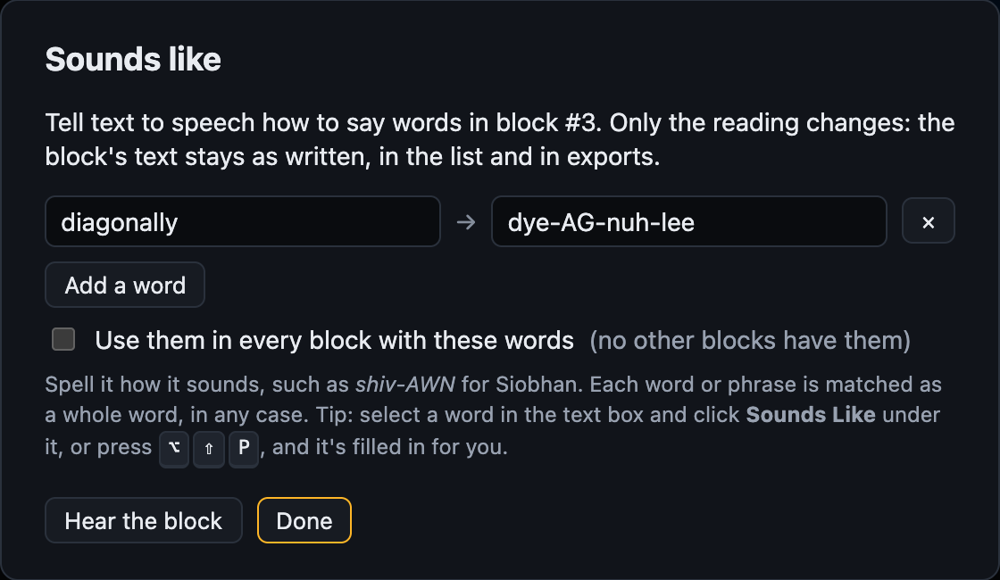
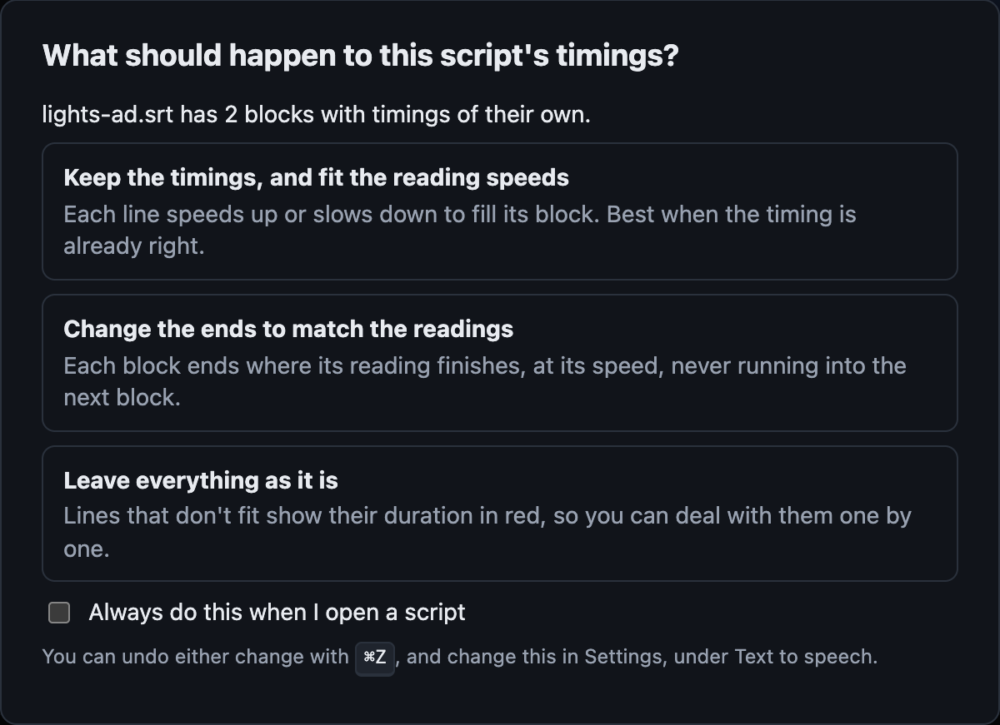

# Writing with text to speech

Hear your lines read aloud, to check each one fits before the next piece of dialogue.

## Turning it on

Text to speech is part of Write mode. Press `Alt+Shift+V`, or open **Settings → Text to
speech** and tick **Turn on text to speech**. That turns it on for every project in this browser.

`TTS` shows under the video while it's on. Click it to turn text to speech off for the open
project only. It then reads `TTS OFF`, and you can drag block ends by hand. Click it again to
turn it back on.

- **Pick a voice,** and click **Test** to hear it read the **Test text**. Nothing changes
  until you click **Apply**, so you can try as many as you like.
- **Language:** only English voices show at first. Pick another language, or **All
  languages**. It narrows the **Natural voices** downloads too. Favourites always show.
- **Favourites:** click ☆ beside a voice to pin it to the top of the list, with a button
  for one-click switching. Click ★ to unpin it.

[Voices](VOICES.md) explains the kinds of voice you can choose.

## Keys

| Key | Action |
| --- | --- |
| `V` | Read the block with the video playing |
| `Shift+V` | Read the block, and set its end to where the reading finishes |
| `[` `]` | Make the block's reading slower / faster |
| `Alt+Shift+V` | Text to speech settings |
| `Alt+Shift+P` | Sounds like: how a word in the block is said |

## How timing works

**A block ends where its reading ends.** As you type, its end moves to match. An `auto`
tag next to the end time shows this. To make a block longer or shorter, change its speed
with `[` `]`, not its end. Moving the block, or changing its start, moves the whole block.

**It never runs into the next block.** If the reading doesn't fit, its time shows in red,
such as `TTS 2.9 s`, and so does the block's length in the list. If there's no way to fit
it, see [Extended AD](#extended-ad).

- `~` before a time means it's an estimate. It becomes exact once the block has been read.
- A dot (●) after a block's length means its reading is made, so the length is exact.

Blocks opened from a file, or marked with `H`, keep their timing until you edit them.

## Speed

- **Speed per block:** very slow (−30%), slow (−15%), normal, fast (+15%), very fast
  (+30%), and experimental +50% and +100%. Use `[` `]` or the speed menu in the open block.
  A block that isn't at normal speed shows it in the list and on the timeline, such as
  `+15%`.
- **Base speed:** a slider in the text to speech settings, from 50% to 150%, for the whole
  project. It's added on top of each block's own speed. Double-click it to go back to
  100%.

## Voice per block

A block can have its own voice, such as a second voice for translated dialogue. Pick it
from the voice menu in the open block. **Same as Settings** goes back to the main voice.
**Replace all voices**, in the text to speech settings, sets every block back to the main
voice.

## Hearing it while you play

While playing, each block is read as the playhead reaches it, and the video's sound goes
down. Start partway through a block and the reading picks up from there.

The **Video / TTS** slider under the video sets how loud the readings are against the
video. Double-click it to make them even.

In the text to speech settings, choose how far the video's sound goes down, and how
quickly. The [full mix](#exporting-the-full-mix) sounds the same.

### Changing one block

The open block has two controls for its sound:

| Control | What it does |
|---------|--------------|
| **Dip** | Lowers the video more or less than the setting, or not at all (**No dip**). **Custom** takes a number such as `+3` or `-3`. |
| **Vol** | Makes the reading quieter or louder, from 25% to 200%. Type a number in the box for an exact one. Double-click the slider for 100%. |

Both build on the settings and the slider: change those, and every block moves with them.

Projects keep both, along with the settings they build on, so a project sounds the same
on any computer. WebVTT exports keep them too.

## Extended AD

Use Extended AD when a description needs more time than the gap gives it. The video pauses
at the block's start while the block is read, then carries on.

| To pause for | Do this |
|---------|---------|
| One block | Click **Extended** in the open block. |
| Every block | Turn on **Extended AD for this project** in the text to speech settings. |

- Pressing `Space` during a pause stops the reading. Press it again to hear the block from the start.
- Jumping elsewhere ends the pause and playback carries on from there.
- An extended block shows as a short marker on the timeline, as it takes none of the video's time. Drag it to move it.
- Clicking **Extended** again gives the block its normal length back.
- The list shows how long each block pauses. The settings show the total.

Narrators read extended blocks with the video stopped. See [Recording](RECORDING.md#extended-blocks).

### Extended blocks in exports

Exports stop the programme for each extended block, so they run longer than the video. The
settings below are under **Extended blocks in exports**, in the text to speech settings.

| Export | With pauses |
|---------|---------|
| Description track | Readings move later by the pauses before them. |
| Full mix | The programme's sound stops during each pause. It can't go in the original video. |
| SRT and WebVTT | Times match the extended video, and blocks show their full reading length. |

To keep the video's timing instead, turn off **Keep the pauses**. Each reading then plays
over the programme, and scripts keep the original times.

For other editors, **Export → Pause list** saves a CSV of where the video stops and for how long.

### Extended video

**Export → Extended video** saves a new video that stops for each extended block. The
picture holds while the block is read, then carries on.

- **To mix it yourself:** turn off **Include the narration** first. You get the programme's sound at its own level, silent during each pause.
- **It takes time:** the whole picture is made again, so a film can take as long as it runs.
- **It needs ffmpeg:** in Docker, it's made for you. Without it, you get the audio and a filter file. Run the command Scribecue shows in a folder with those and the video.
- **Once the narrator has recorded:** make it from their narration WAV instead, so it stops for their reads. See [An extended video for the narration](RECORDING.md#an-extended-video-for-the-narration).

## Exporting the full mix

**Export → Full mix** saves the video's sound and the readings together in one file. It
sounds just as it does when you play. It needs a Piper, Kokoro, Google or Amazon Polly voice.

Choose how under **Export full mix**, in the text to speech settings:

| Setting | Choices |
|---------|---------|
| **Save as** | WAV: about 1.4 GB for a two-hour film. MP3: about 170 MB, and a few minutes slower to make. |
| **Loudness** | As it comes, or a target: −23 LUFS for broadcast in Europe, −24 LUFS in North America, −16 LUFS for podcasts, −14 LUFS for streaming. A target takes twice as long. |
| **Stems** | Also save the video's sound and the readings as separate files, to mix again in an editor. Your browser may ask to allow several downloads. |

For a video with several audio tracks, it uses the one that's playing.

### Putting it in the video

- **With ffmpeg on your computer:** after the export, Scribecue shows a command. Copy it,
  and run it in a folder with the video and the mix.
- **Running Scribecue in Docker:** add [ffmpeg](INSTALL.md#the-full-mix-in-the-video-ffmpeg),
  then choose **In the video**. You get the video back with the mix as an extra audio
  description track, or in place of its sound.

Both work with MP4, MOV, MKV and WebM videos. In Docker, ffmpeg can also save the mix as
AAC, AC-3 or E-AC-3.

To mix it yourself instead, see [Mixing](MIXING.md).

## Sounds like

When a voice says a word wrong, tell it how to say it, without changing your text.

1. Select the word, then click **Sounds like** under it, or press `Alt+Shift+P`.
2. Spell it how it sounds, such as *shiv-AWN* for Siobhan.
3. Click **Hear the block** to check.

Tick **Use them in every block with these words** to fix the word everywhere at once.
Readings and the description track use the new sound. The script and SRT exports keep
the word as written.

Sounds like is for text to speech. To tell a narrator, use the block's **Notes**.

## Notes in [square brackets]

If you write notes such as `[Wide shot, hold for the door]` in the script, tick **Don't
read notes in [square brackets]** in the text to speech settings. They stay in the script
but aren't read or timed.

## Changing many blocks at once

These are in the text to speech settings. Each asks first, runs in the background with a
**Stop** button, and `Ctrl/Cmd+Z` undoes it.

- **Update all timings:** sets every block's end from its reading. With a browser voice,
  tick **Read each block silently first** for exact lengths.
- **Fit speeds to timings:** the opposite. Every block keeps its timing, and its reading
  speeds up or slows down to fill it. Use it for a script whose timing is already right.
- **Make all readings:** with a Piper, Kokoro, Google or Amazon Polly voice, makes every reading now, so
  each one plays straight away. Timings don't change.

**When you change the voice or base speed,** every reading's length changes. Scribecue
asks whether to update the blocks' ends to match, or leave them.

**When you open a script** (SRT, WebVTT or `.adc`), Scribecue asks what to do with its timings:

| Choice | What happens |
|---|---|
| Keep the timings, and fit the reading speeds | Each reading speeds up or slows down to fill its block. |
| Change the ends to match the readings | Each block ends where its reading does. |
| Leave everything as it is | Nothing changes yet. A block's end follows its reading once you edit its text or speed. |
| Leave everything, and turn off text to speech | Nothing changes, and text to speech is off for this project. Click `TTS OFF` under the video to turn it on again. |

**When a Frazier `.adc` script names voices,** Scribecue first asks whether to use them.
Choose other voices to pick one in place of each.

If you use the script's voices and all of them are set up here, its timings already fit.
Scribecue keeps them and doesn't ask about timings.

Tick **Always do this** on the timings questions to stop them asking. You can change your answer
later in the text to speech settings.

## Good to know

- **Saving:** block speeds, voices, sounds-like words and Extended are saved in projects
  and WebVTT exports. SRT files can't hold them. Frazier `.adc` scripts bring their speeds and base
  speed with them.
- **Stored readings:** Piper, Kokoro, Google and Amazon Polly readings are kept in your browser,
  up to 250 MB, so they play straight away next time and Google or Amazon isn't asked again. The **Storage** section
  of Settings shows them and can clear them.
- **Playback speed:** the voice follows the video's playback speed.

## Hand off for QC

Scribecue [checks spelling and grammar](GETTING-STARTED.md#checking-spelling-and-grammar) first.
Then choose **Export → QC package**. It keeps the audio of Google, Amazon Polly and Kokoro blocks, so
reviewers need no key or Docker. Their computer reads Piper blocks. Built-in computer
voices can't be used. See [QC review](QC.md#make-a-portable-qc-package).
