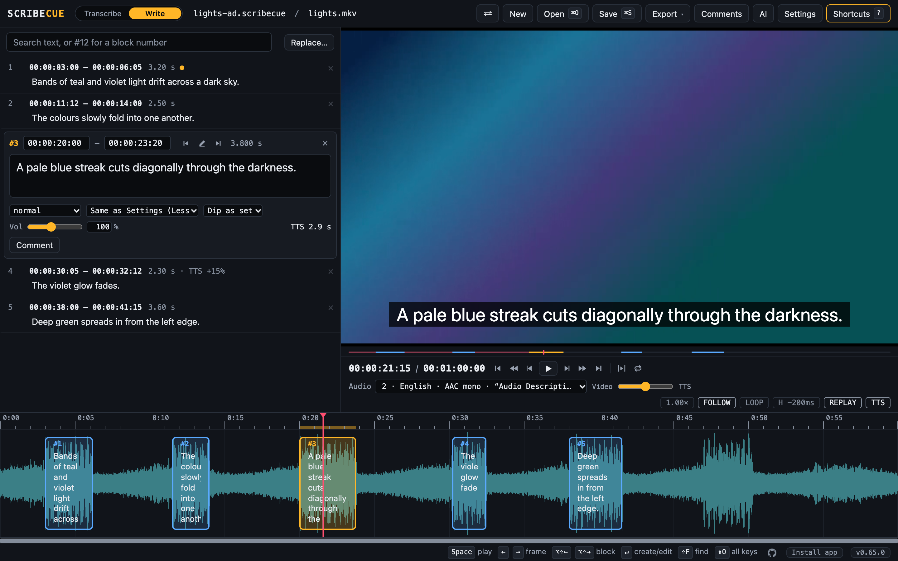

# Scribecue

**A keyboard-first workspace for audio description.**

Write and time scripts, review descriptions, and record narration against your video.
Handle pickups, work with text to speech, or transcribe existing description.

- **Write** new audio description, and hear each line read aloud to check it fits before
  the next piece of dialogue. Export the readings as an audio track, or as a full mix with
  the programme, ready to put into the video with ffmpeg.
- **Transcribe** existing audio description: hold a key while the narrator speaks, and a
  block appears at that time. Speech to text can type the line for you.
- **QC** scripts with optional corrections, comments and portable original TTS readings.
- **Record** the narration: a narrator records each block against the video, and the mixer
  gets one timestamped WAV.
- **Private:** your video and audio are never uploaded. A script you share is encrypted first.
- **See the gaps:** a video's subtitles show as a dialogue lane on the timeline.
- **Float the video:** double-click it to move it, resize it, or put it on another screen.
- **Familiar keys** if you've used Frazier.
- Opens and saves SRT and WebVTT scripts, and opens Frazier's `.adc` scripts.

## Get started

### Use it in your browser

1. Open **<https://scribecue.kyleadvoice.ca/>** in Chrome or Edge.
2. Follow the short tour and setup. You can skip either.

To give Scribecue its own window and icon, click **Install app** in the bottom right.

**Which browser:** Scribecue is built for Chrome and Edge. Brave, Opera, Vivaldi and Arc
usually work too. Safari and Firefox can open it, but some features may be missing, and
Scribecue tells you which. Phones and tablets aren't supported, because Scribecue needs a
keyboard. See [what your computer needs](Guides/GETTING-STARTED.md#what-your-computer-needs).

**Working offline:** once you've opened Scribecue, it works without a connection. So do
Piper voices and speech to text, once downloaded. **Settings → Offline and storage** shows
what's ready for offline use, and has **Remove all data** to clear everything Scribecue
keeps in your browser. Your project files aren't touched.

### Or run it yourself

Run Scribecue on your own computer with Docker to keep everything there, the app
included, and to add Kokoro voices and more. [Running it yourself](Guides/INSTALL.md) walks you
through it. In the web version, **Settings → General → Run it on your computer** opens
that guide.

## Guides

The guides also open inside Scribecue: press `?` and click **Guides**.

- [Getting started](Guides/GETTING-STARTED.md): modes, the loop you work in, saving and exporting.
- [Writing with text to speech](Guides/WRITING.md): hearing your lines, speeds and timing.
- [Voices](Guides/VOICES.md): the voices on your computer, Piper, Kokoro, Google and Amazon Polly.
- [Transcribing](Guides/TRANSCRIBING.md): marking existing audio description, and speech to text.
- [QC review](Guides/QC.md): checking scripts and audio, comments, and review handoffs.
- [Recording narration](Guides/RECORDING.md): the recording file, Record mode and the narration WAV.
- [Mixing](Guides/MIXING.md): the full mix, and the files a mixer uses in a DAW.
- [AI help](Guides/AI.md): drafting descriptions with an AI model.
- [Sharing a project](Guides/SHARING.md): working on a project with others, live.
- [Keyboard shortcuts](Guides/SHORTCUTS.md): every key, and how to change them.
- [Google voices](Guides/GOOGLE-VOICES.md): setting up Google Cloud voices without being billed.
- [Amazon Polly voices](Guides/POLLY-VOICES.md): setting up Polly voices with a spending limit.
- [Running it yourself](Guides/INSTALL.md): Docker, Piper, Kokoro, Whisper and Ollama.
- [Troubleshooting](Guides/TROUBLESHOOTING.md): common problems, and what to do.

## Privacy

- **Your files stay on your computer.** Video, audio and scripts are opened from your disk
  and never uploaded. A script you share goes to the sharing service encrypted.
- **Nothing else is contacted unless you turn it on.** A strict security policy blocks the
  page from reaching other sites, except for things you choose to use:
  - the [update check](#updating) in the Docker version, if you agree to it;
  - an [AI provider](Guides/AI.md), once you connect one, when you send a message or ask for a
    draft;
  - TMDB, when you click **Look up the cast** in AI help;
  - [online, Google Cloud and Amazon Polly voices](Guides/VOICES.md), which send each line's text
    to be read;
  - the [sharing service](Guides/SHARING.md), once you share a project or open a shared one.
    It can't read what it passes on.
- **Piper, Kokoro and speech to text run on your computer,** in your browser or in
  containers with no internet access. Your audio never leaves your computer.
- **The web version** is downloaded from GitHub Pages the first time and when it updates.
  To keep even that on your computer, [run it yourself](Guides/INSTALL.md).

## Updating

The web version updates itself. If an update arrives while you're working, the version
number in the bottom right says **update ready**: click it, or open Scribecue again later.

If you run it yourself, see [Updating](Guides/INSTALL.md#updating).

## Development

Scribecue is plain HTML, CSS and JavaScript, with no build step.
[Development](Guides/INSTALL.md#development) covers running it, the checks to run before
committing, and releases. Contributing with an AI agent? It should read [AGENTS.md](AGENTS.md).

## Credits

The keyboard layout is modelled on [Frazier](https://www.videotovoice.com/) by
videotovoice, so writers who know Frazier don't need to relearn keys. Thanks to the
Frazier team for publishing their shortcut cheat sheet.

Voices use these open-source projects, downloaded only when you choose a voice or build
its container:

- [Piper](https://github.com/OHF-Voice/piper1-gpl) by the Open Home Foundation (GPL). In
  the web version it runs with [ONNX Runtime Web](https://github.com/microsoft/onnxruntime)
  by Microsoft (MIT), [piper-wasm](https://github.com/diffusion-studio/piper-wasm) and
  [espeak-ng](https://github.com/espeak-ng/espeak-ng) (GPL). Each voice has its own
  licence, on its [voice page](https://huggingface.co/rhasspy/piper-voices).
- [Kokoro-82M](https://huggingface.co/hexgrad/Kokoro-82M) by hexgrad (Apache 2.0), run with
  [kokoro-onnx](https://github.com/thewh1teagle/kokoro-onnx) by thewh1teagle (MIT) and
  espeak-ng (GPL).

The spelling check uses [nspell](https://github.com/wooorm/nspell) by Titus Wormer (MIT) and
dictionaries from [SCOWL](http://wordlist.aspell.net/) (MIT and BSD), in `app/vendor`.

MP3 exports use [lamejs](https://github.com/zhuker/lamejs) by Alex Zhukov, a JavaScript
version of the [LAME](https://lame.sourceforge.io/) MP3 encoder (LGPL), unchanged, in
`app/vendor`. AC-3 and E-AC-3 sound is decoded with
[@mediabunny/ac3](https://github.com/Vanilagy/mediabunny/tree/main/packages/ac3) by
Vanilagy (MPL 2.0), which is [FFmpeg](https://ffmpeg.org)'s decoder (LGPL), also unchanged
in `app/vendor`. The ffmpeg container installs [FFmpeg](https://ffmpeg.org) (LGPL and GPL)
from Alpine Linux's packages when it's built.

Scribecue is an independent project. It is not affiliated with, endorsed by or connected
to Frazier or videotovoice. Frazier is their product name, used here only to describe
familiar behaviour, such as the keyboard layout and how blocks are laid out and timed, and
to say which scripts Scribecue can open.

## License

[MIT](LICENSE)
