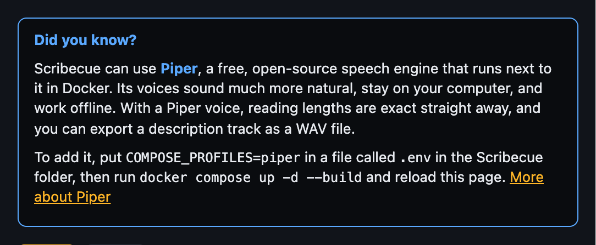

# Scribecue

**A keyboard-first editor for audio description scripts.**

- **Transcribe** existing audio description at its original timing: hold a key while the
  narrator speaks and a block appears.
- **Write** new audio description, with text to speech to hear each line and check it fits
  before the next piece of dialogue.
- Runs on your own computer in Docker. Your files are never uploaded.
- Uses the same keyboard layout as Frazier, so Frazier users don't need to relearn keys.
- Scripts open and save as SRT or WebVTT files.


## Quick start

### The easy way: use it in your browser

1. Open **<https://kyle95wm.github.io/Scribecue/>** in Google Chrome or Microsoft Edge.
2. Optional: click **Install app** in the bottom right, or the install icon in the address
   bar. Scribecue then gets its own window and icon, like any other app, and works
   offline.

That's all. A short setup asks what you're working on and turns on the tools for it.

The web version updates itself. When a new version is ready, it asks you to reload. Your
video, audio and scripts are opened straight from your computer and never uploaded:
only the app itself is downloaded, from GitHub, the first time and when it updates.
[Piper voices](#piper-voices) work in the web version too: download one from the text to
speech panel.

Scribecue is built for Chrome and Edge. Other browsers, such as Safari and Firefox, can
open it, but some features may not be available, and Scribecue tells you which.

### Run it yourself with Docker

This keeps everything, the app included, on your computer, and adds the option of Piper
voices. You'll need three free things. Install any you don't have yet:

- **[Docker Desktop](https://www.docker.com/products/docker-desktop/)**, which runs
  Scribecue. On Linux, Docker Engine with the Compose plugin works too. Start it once
  after installing, and leave it running.
- **[Git](https://git-scm.com/downloads)**, to download Scribecue and its updates. It's
  already on most Macs and Linux computers.
- **A recent Chrome or Edge**, to use Scribecue in.

Then open a terminal: **Terminal** on a Mac or Linux, or **PowerShell** on Windows. Run
these one at a time.

1. Download Scribecue:

   ```bash
   git clone https://github.com/kyle95wm/Scribecue.git
   ```

2. Go into its folder:

   ```bash
   cd Scribecue
   ```

3. Build and start it. The first time takes a minute or two:

   ```bash
   docker compose up -d --build
   ```

4. Open <http://localhost:8484> in Chrome or Edge.

A short setup opens and asks what you're working on, then turns on the tools for it. You
can run it again any time with **Setup** at the top.

Scribecue keeps running in the background, and starts again whenever Docker does, until
you stop it. To stop it, run `docker compose down` in the `Scribecue` folder. To start it
again, run `docker compose up -d` there.

### Optional: natural-sounding voices

For text to speech voices that sound natural and run on your computer, add
[Piper](#piper-voices) before step 3 by creating a file called `.env` in the `Scribecue`
folder. On a Mac or Linux:

```bash
echo "COMPOSE_PROFILES=piper" > .env
```

On Windows, in PowerShell:

```powershell
Set-Content .env "COMPOSE_PROFILES=piper"
```

Then carry on with step 3. Piper adds about 1 GB to the download. If Scribecue is already
running, run step 3 again to add it.

### If something goes wrong

- **"Cannot connect to the Docker daemon"** or a similar error: Docker Desktop isn't
  running. Start it, wait until it says it's running, and try again.
- **"port is already allocated":** something else is using port 8484. Add a line such as
  `SCRIBECUE_PORT=9000` to the `.env` file (create it if it isn't there), run step 3
  again, and open <http://localhost:9000> instead.
- **The page doesn't load straight away:** wait a few seconds after step 3, then reload.

To get a newer version later, see [Updating](#updating).

## Contents

- [Quick start](#quick-start)
- [Basic workflows](#basic-workflows)
  - [The writing loop](#the-writing-loop)
  - [The transcribing loop](#the-transcribing-loop)
  - [Saving](#saving)
  - [Getting around](#getting-around)
  - [Adjusting timing](#adjusting-timing)
- [Modes: Transcribe and Write](#modes-transcribe-and-write)
- [Transcribing audio description](#transcribing-audio-description)
  - [Hold-to-mark](#hold-to-mark)
  - [Looping a block](#looping-a-block)
  - [Text to speech](#text-to-speech)
  - [Piper voices](#piper-voices)
- [Files with several audio tracks](#files-with-several-audio-tracks)
- [Other handy features](#other-handy-features)
- [Keyboard shortcuts](#keyboard-shortcuts)
  - [Keys on Mac, Windows and Linux](#keys-on-mac-windows-and-linux)
- [Supported files](#supported-files)
- [Privacy](#privacy)
- [Updating](#updating)
- [Development](#development)
- [Credits](#credits)
- [License](#license)

## Basic workflows

Most of the work is one short loop, repeated for every line. Learn the few keys in it and
you'll rarely need anything else. Press `?` at any time to see every shortcut.

### The writing loop

For new audio description, in **Write** mode with text to speech on (`Alt+Shift+V`, or
**Setup**). Open the video with `Ctrl/Cmd+Shift+O`, then repeat:

1. **Find a gap.** Play until there's room for a description, and stop there.
   - `Space` plays or pauses.
   - `←` `→` move one frame, to get the exact spot.
2. **Write the description.**
   - `Enter` makes a block at the playhead and opens it for typing.
   - Type the line. Its end follows how long the reading takes, and the reading time turns
     red if the line doesn't fit before the next block.
   - `Esc` closes the block.
3. **Listen to it.**
   - `V` reads the block aloud with the video.
   - `[` `]` make this block's reading slower or faster.

Then carry on playing to the next gap.

### The transcribing loop

For existing audio description, in **Transcribe** mode. Open the video with
`Ctrl/Cmd+Shift+O`. If it has a description track and you don't hear it, press `T` to
switch tracks. Then repeat:

1. **Play to the next line.**
   - `Space` plays or pauses.
2. **Mark it.**
   - Hold `H` while the narrator speaks, and let go when they stop. Playback pauses, and a
     block opens for typing.
3. **Type it.**
   - Type the line.
   - `Enter` or `Esc` closes the block, and playback carries on.

To hear a block again while you type, press `L`. It loops until you close the block.

### Saving

**Save your work as a project** with `Ctrl/Cmd+S`. A project (`.scribecue`) keeps
everything: the blocks, each block's text to speech speed and whether its end follows the
reading, the mode and its settings, where you were, and which video it belongs to. Keep
one per programme, and open any of them with `Ctrl/Cmd+O`.

- The first save asks where to put the file. After that, `Ctrl/Cmd+S` saves straight back
  to it, even after a reload. `Ctrl/Cmd+Shift+S` saves a copy under a new name.
- A dot after the project name at the top, such as `lights-ad.scribecue •`, means there
  are changes you haven't saved yet.
- Browsers can't remember where a video is, so after opening a project, open its video
  with `Ctrl/Cmd+Shift+O`. Scribecue tells you which one, and warns you if you pick a
  different file.
- **New**, at the top left, starts a fresh project: it closes the video and clears every
  block. It asks first. `Ctrl/Cmd+Z` brings the blocks back, but you'd open the video again.

Saving in place needs Chrome or Edge. Other browsers download a copy of the project each
time you save.

**Export** when the script is finished, or to hand it to someone who doesn't use
Scribecue, such as another writer or a QC reviewer:

- `Ctrl/Cmd+E` exports SRT.
- `Ctrl/Cmd+Shift+E` exports WebVTT, which also keeps each block's text to speech speed.
- With a [Piper voice](#piper-voices), **Export description track** in the text to speech
  panel saves the readings as a WAV file.

`Ctrl/Cmd+O` also opens SRT and VTT files. Your work in progress is saved in the browser
as you go too, so reloading the page doesn't lose anything.

### Getting around

| To | Press |
| --- | --- |
| Play or pause | `Space` |
| Move one frame back or forward | `←` `→` |
| Move 3 seconds back or forward | `Shift+←` `Shift+→` |
| Go to the previous or next block | `Alt+Shift+←` `Alt+Shift+→`, or `↑` `↓` |
| Go to the start or end of the selected block | `G` / `Shift+G` |
| Go to the beginning or end of the video | `Home` / `End` (`Fn+←` / `Fn+→` on Mac laptops) |
| Go to a time | `Alt+Shift+J`, then type it, such as `1:23.5` |
| Go anywhere | Click the timeline, or drag along the time ruler above it |
| Jump around the whole video | Click or drag the scrubber bar under the video. It stays a thin line until you point at it. Blocks show as marks along it, the selected one highlighted, and hovering shows the time |

### Adjusting timing

| To | Press |
| --- | --- |
| Set the block's start or end to the playhead | `A` / `S` |
| Move the start or end by 100 ms | `Q` `W` / `E` `R` (with `Shift`: 10 ms) |
| Move the whole block by 100 ms | `,` `.` (with `Shift`: 10 ms) |
| Set the end to where the reading finishes (Write) | `Shift+V` |
| Drag a block, or its edges | Mouse, on the timeline |

## Modes: Transcribe and Write

The switch next to the Scribecue name picks what you're doing, and shows only the features
for it. Your choice is remembered. The setup that opens the first time you use Scribecue
asks this too, along with the tools for that mode and whether to check for updates.
**Setup** at the top runs it again. Nothing changes until you press **Finish**.

| | Transcribe | Write |
| --- | --- | --- |
| For | Existing audio description, at its original timing | New audio description |
| [Hold-to-mark](#hold-to-mark) (`H`, `Shift+H`) | ✓ | |
| [Text to speech](#text-to-speech) (`V`, `Shift+V`, `[` `]`, reading times, block speeds) | | ✓ |
| Everything else | ✓ | ✓ |

Switching only hides features. Block speeds and settings are kept for when you switch
back. Pressing a key from the other mode tells you which mode it's in.

## Transcribing audio description

### Hold-to-mark


In Transcribe mode:

1. Play the file with the description track selected.
2. **Hold `H`** while the narrator speaks a line. A dashed block grows on the timeline.
3. **Let go** when they stop. Playback pauses and the new block opens for typing.
4. Type the line and press `Enter` or `Esc`. Playback carries on.

Scribecue tidies up the timing for you:

| | What happens | Change it with |
| --- | --- | --- |
| **Reaction offset** | Both edges move back 200 ms, because your key press comes a moment after you hear the voice. | `Shift+H`, or click `H −200ms` under the video (0–300 ms) |
| **Starting from pause** | If you pause first and then hold `H`, the block starts exactly where you paused, with no offset. | |
| **No overlaps** | A new block is trimmed to fit the gap it starts in. | |

Your offset choice is remembered.

### Looping a block

Press `L`, or click the loop button under the video, to loop the block under the playhead
(or the selected block). Press `Enter` to type
while it repeats, then `Esc` when you're done, and the loop stops. Press `L` again to stop
it without editing.

For a loop that stays on until you turn it off, use `O` instead.

### Text to speech

Hear your lines read aloud, to check where each one sits and whether it fits before the
next piece of dialogue. It's part of Write mode, and off until you turn it on: press
`Alt+Shift+V`, or click `TTS` under the video, then tick **Turn on text to speech**.
**Test**, next to the voice, reads a short sample line so you can hear each voice.


| Key | Action |
| --- | --- |
| `V` | Read the block from its start, with the video playing. Playback stops at the block's end, or where the reading ends if it runs over |
| `Shift+V` | Read the block, then set its end to where the reading finishes |
| `[` `]` | Make the selected block's reading slower / faster |
| `Alt+Shift+V` | Choose the voice and speed |
| `Alt+Shift+P` | Sounds like: how words in this block are said |

- **Speed:** very slow (−30%), slow (−15%), normal, fast (+15%), very fast (+30%), and
  experimental +50% and +100%. The voice also follows the playback speed.
- **Speed per block:** set a block's own speed with `[` `]` or the **TTS** menu in the
  block editor. Blocks with their own speed show it in the list and on the timeline, such
  as `+15%`. The rest follow the overall speed. Setting a block back to the overall speed
  makes it follow that again. Block speeds are saved with your work and in exported VTT
  files, as notes that other programs ignore. SRT files can't store them.
- **Read blocks aloud while playing:** each block is read as the playhead reaches it,
  with the original audio turned down. You can turn either part off.
- **Opening a script:** when you open an SRT or VTT script in Write mode with text to
  speech on, Scribecue asks what to do with its timings: keep them and fit the reading
  speeds, change the ends to match the readings, or leave everything as it is. Tick
  **Always do this** to stop it asking, and change your choice later under **When you open
  a script** in the text to speech panel. Either change can be undone. Opening a Scribecue
  project doesn't ask.

  
- **Fit speeds to timings:** the opposite of Update all timings, for a script whose
  timing is already right, such as one opened from a file. Every block keeps its timing,
  and its reading speeds up or slows down to fill it, within −50% to +100%. Blocks with a
  speed you picked keep it. It asks first, and `Ctrl/Cmd+Z` undoes it. With a Piper voice
  the fit is exact. The blocks then keep fitting as you edit their text or resize them.
- **Resizing changes the speed:** in Write mode, change a block's length by dragging an
  edge, with `A` `S` `Q` `W` `E` `R`, or by typing in IN or OUT, and its reading speeds up or
  slows down to fill the new length. The block's speed then shows as custom, such as
  `custom (−12%)`, and keeps fitting as you edit the text. It stays between −50% and
  +100%. Picking a speed for the block yourself, from its menu or with `[` `]`, keeps that
  speed when you resize; setting it back to default lets resizing fit it again. Turn this
  off with **Change a block's reading speed when you resize it** in the text to speech
  panel.
- **Sounds like:** when a voice says a name or word wrong, tell it how to say it, without
  changing the text. Select the word in the text box and press `Alt+Shift+P` (or click
  **sounds like** next to the block's speed), then spell it how it sounds, such as
  *shiv-AWN* for Siobhan, and click **Hear the block** to check. Each block keeps its own
  list. Words are matched whole and in any case, so the reading, its length and the
  exported description track all use the new sound, while the list, SRT exports and the
  timeline show the words as written. Projects and VTT exports keep the list, as notes
  other programs ignore. `Ctrl/Cmd+Z` undoes a change.

  
- **Notes in [square brackets]:** if your team writes notes in the script inside square
  brackets, such as `[Wide shot, hold for the door]`, tick **Don't read notes in [square
  brackets]** in the text to speech panel. They're then left out of every reading, reading
  time and auto end, and out of the exported description track, but stay in the script and
  in SRT and VTT exports.
- **Ends set from the reading:** while text to speech is on, a new block made with `Enter` or
  `N` takes its end from how long the reading takes, and keeps following it as you type
  or change the speed. An `auto` tag next to OUT shows this. It never runs into the next
  block. Once you set the end yourself, by dragging, `S`, `E` / `R` or typing in OUT,
  the block keeps it. Blocks marked with `H`, drawn on the timeline or opened from a file
  are never changed. You can turn this off in the text to speech panel.
- **Update all timings:** a button in the text to speech panel sets the end of every block
  with text from its reading, using each block's own speed. It asks first, because it also
  changes blocks marked with `H` or opened from a file, and `Ctrl/Cmd+Z` undoes it. Ends never run
  into the next block. With a [Piper voice](#piper-voices) the lengths are always exact.
  With a browser voice, tick **Read each block silently first** for exact lengths. That
  takes about as long as reading them all, shows its progress, and can be stopped.
- **Timing check:** the editor shows how long the reading takes, such as `TTS 2.9 s`, in red
  if it's longer than the block, and the list shows that block's duration in red. `~`
  means it's an estimate. It becomes exact once the
  block has been read, and the estimates get more accurate for a voice as you use it.

Scribecue uses the voices built into your computer, so the text stays on it. For much more
natural voices that also stay on your computer, [use Piper](#piper-voices). Mac and
Windows come with several built-in voices. On Linux, browsers read through speech-dispatcher, so you may
need to install it with a voice such as espeak-ng from your distribution's packages.

**Online voices** are a separate opt-in in the same panel. They often sound more natural,
but each block's text is sent to the company that runs the voice, such as Google or
Microsoft, to be spoken. Leave them off if your script mustn't leave your computer.
They come from the browser, so which ones you get depends on where you open Scribecue:
Microsoft Edge has dozens, Chrome has a few Google voices, and Safari and Firefox have
none. They only work while you're online.

To add more voices that stay on your computer, then reload Scribecue:

- **Mac:** System Settings → Accessibility → Spoken Content, click ⓘ next to **System
  voice**, and download an "Enhanced" or "Premium" voice.
- **Windows:** Settings → Time & language → Speech, then **Add voices**.
- **Linux:** install more speech-dispatcher voices from your distribution's packages.

Not every browser lists every installed voice.

The browser's own voices can only be heard, not recorded. To export the readings as an
audio file, use a [Piper voice](#piper-voices).

### Piper voices

[Piper](https://github.com/OHF-Voice/piper1-gpl) is an open-source speech engine with
natural-sounding voices. The voices run on your computer, so your script never leaves it,
and they work offline. In the [web version](#in-the-web-version) Piper runs in your
browser; [with Docker](#with-docker) it runs in a second container, next to the editor.

With a Piper voice:

- **Lengths are exact straight away.** The editor's `TTS` time, the red durations, block
  ends set from the reading and **Update all timings** all use the real reading, with no
  silent read-through.
- **Each line always takes the same time,** so the timing you see is the timing you get,
  between sessions and in the export.
- **You can export a description track.** **Export description track** in the text to
  speech panel saves every block's reading as one WAV file, each starting at its block's
  start, as long as the video. It's ready to mix with the programme. Readings that run into
  the next block overlap in the file, and the panel tells you how many.

Four English voices are offered: Lessac and Ryan (US), and Alba and Alan (UK).

#### In the web version

In Write mode, open the text to speech panel (`Alt+Shift+V`, or `TTS` under the video),
turn text to speech on, and under **Natural voices** pick a voice and click **Download**. Each voice is about 63 MB.
The first one also brings the speech engine, about 33 MB, which all the voices share.
Once it's downloaded, the voice is chosen for you and works offline. The files come from
Scribecue's own site and stay in your browser; to free the space, pick the voice and click
**Remove**.

Readings take a moment longer than with Docker, as they run in the browser, but they're
the same length to the hundredth of a second.

#### With Docker

Until you add it, the text to speech panel ends with a short note about it:



To add it, create a file called `.env` in the Scribecue folder containing:

```
COMPOSE_PROFILES=piper
```

Then build and start both containers:

```bash
docker compose up -d --build
```

The first build downloads Piper and its voices, about 1 GB in all. After that, Piper has no
internet access, and only Scribecue's own server can reach it. Reload Scribecue, switch to
Write mode, and pick a voice from the **Piper** group at the top of the voice menu.

To choose other voices, add a line like this to `.env`, with names from the
[Piper voice list](https://huggingface.co/rhasspy/piper-voices), then build again:

```
PIPER_VOICES=en_US-lessac-medium en_GB-jenny_dioco-medium
```

To stop using Piper, remove the `COMPOSE_PROFILES` line from `.env` and run
`docker compose down`, then `docker compose up -d`.

## Files with several audio tracks

When a file has more than one audio track, such as the original mix and an audio
description mix, an **Audio** picker appears under the video. Press `T` / `Shift+T` to switch
tracks. The waveform always shows the track you're hearing.

A track marked as audio description is picked automatically. Scribecue looks for
Matroska's visually-impaired flag, an MP4 `kind` box, or a name containing "description",
"AD" or "narration".

<details>
<summary>How track switching works</summary>

Chrome and Firefox can only play a video's default audio track. So Scribecue copies the
chosen track out, without re-encoding, into an audio-only file in memory, and plays it in
step with the muted video. Each track is copied once per session, so switching back
afterwards is instant. Safari switches tracks itself.

</details>

## Other handy features

- **Search:** the box above the list filters blocks by text, or by number with `#12`.
  Press `/` to jump to it. `Shift+F` opens quick navigation, and `Alt+Shift+J` jumps to a timecode.
- **Player controls:** the buttons under the video step to the previous or next block,
  jump 3 seconds or one frame, play or pause, play just the selected block, and loop the
  block under the playhead. Hover over one to see its key.
- **Copy a timecode:** click the clock under the video. To set a block's start or end to
  the playhead, press `A` or `S`.
- **Mouse:** drag a block to move it, drag an edge to resize it, or drag across empty
  space to draw a new block. Scroll to pan, and `Ctrl/Cmd`+scroll or pinch to zoom.

## Keyboard shortcuts


The layout follows the
[Frazier cheat sheet](https://www.videotovoice.com/docs/en/cheatsheet/mac.html).
See [Keys on Mac, Windows and Linux](#keys-on-mac-windows-and-linux) for how the modifier
keys are named on each system.

<details open>
<summary><strong>Timeline</strong></summary>

| Key | Action |
| --- | --- |
| `Space` | Play / pause |
| `←` `→` | One frame back / forward |
| `Shift+←` `Shift+→` | Three seconds back / forward |
| `Alt+Shift+←` `Alt+Shift+→` | Previous / next block |
| `Home` `End` | Beginning / end of the video (`Fn+←` `Fn+→` on Mac laptops) |
| `Alt+Shift+J` | Jump to a timecode (`hh:mm:ss.mmm`, `hh:mm:ss:ff`, `mm:ss` or seconds) |
| `Shift+F` | Quick navigation: find a block by text or number |
| `+` `-` | Faster / slower playback |
| `Enter` | Create or edit a block |
| `Alt+Shift+D` | Delete a block (asks first) |
| `Shift+O` or `?` | Show all shortcuts |

</details>

<details open>
<summary><strong>Block editor</strong></summary>

| Key | Action |
| --- | --- |
| `Tab` `Shift+Tab` | Next / previous field (text → IN → OUT) |
| `Esc` or `Enter` | Close the editor |
| `Shift+Enter` | New line |
| `↑` `↓` | Previous / next block (from the first / last line) |
| `Alt+Shift+←` `Alt+Shift+→` | Move the block one frame back / forward |
| `Alt+Space` | Play / pause while typing |
| `Ctrl/Cmd+B` `Ctrl/Cmd+I` `Ctrl/Cmd+U` | Bold / italic / underline |
| `Ctrl/Cmd+Z` `Ctrl/Cmd+Shift+Z` | Undo / redo |
| `Ctrl/Cmd+S` / `Ctrl/Cmd+Shift+S` | Save the project / save it as a new file |
| `Ctrl/Cmd+E` / `Ctrl/Cmd+Shift+E` | Export SRT / WebVTT |
| `Ctrl/Cmd+O` / `Ctrl/Cmd+Shift+O` | Open a project or script / open a video or audio file |

</details>

<details open>
<summary><strong>Extras</strong> (on keys Frazier leaves free)</summary>

| Key | Action |
| --- | --- |
| Hold `H` | [Hold-to-mark](#hold-to-mark) a block while the narrator speaks |
| `Shift+H` | Change the hold-to-mark reaction offset |
| `L` | [Loop this block](#looping-a-block) until you finish editing it |
| `N` | New block at the playhead |
| `A` / `S` | Set start / end to the playhead |
| `Q` `W` | Start −/+ 100 ms (with `Shift`: 10 ms) |
| `E` `R` | End −/+ 100 ms (with `Shift`: 10 ms) |
| `,` `.` | Move the block −/+ 100 ms (with `Shift`: 10 ms) |
| `X` / `M` | Split at the playhead / merge with the next block |
| `Del` | Delete the block straight away (undo with `Ctrl/Cmd+Z`) |
| `↑` `↓` or `K` `J` | Previous / next block |
| `PgUp` `PgDn` | Jump 10 blocks |
| `G` / `Shift+G` | Playhead to the block's start / end |
| `C` | Select the block under the playhead |
| `Shift+Space` | Play just the selected block |
| `T` / `Shift+T` | Next / previous audio track |
| `/` | Search the block list |
| `O` | Loop on / off |
| `F` | Follow the playhead on / off |
| `V` / `Shift+V` | [Read the block aloud](#text-to-speech) / fit the block to the reading |
| `[` `]` | Make the block's reading slower / faster |
| `Alt+Shift+V` | Text to speech settings |
| `Alt+Shift+P` | [Sounds like](#text-to-speech) for the selected block |
| `Alt+=` `Alt+-` `Alt+0` | Zoom the timeline in / out / to fit |
| `\` | Reset speed to 1× |

</details>

### Keys on Mac, Windows and Linux

The keys are in the same places on every system. `Ctrl/Cmd` means `Ctrl` on Windows and
Linux and `Cmd` (⌘) on a Mac. `Alt` is `Option` (⌥) on a Mac. Scribecue shows the right
names for your system in the app.

One key differs, to avoid a clash with the system: **play / pause while typing** is
`Alt+Space` on a Mac and `Ctrl+Space` on Windows and Linux, because Windows keeps
`Alt+Space` for the window menu.

If `Alt+Shift` switches your keyboard layout on Windows, the block shortcuts also have
other keys: `↑` `↓` or `K` `J` for previous / next block, and `Del` to delete. You can also
drop a media file on the window instead of pressing `Ctrl+Shift+O`.

Frazier features that Scribecue doesn't have aren't included: glossaries, snippets,
markers, comments, pronunciation, extended audio description, and instruction or pause
marks. Their keys show a short notice instead.

## Supported files

| | Supported |
| --- | --- |
| **Projects** | Scribecue projects (`.scribecue`), to open and save |
| **Scripts** | SRT and WebVTT, to open and to export |
| **Video and audio** | MP4, MOV, M4A, MKV, WebM and WAV, with AAC, Opus, Vorbis, FLAC, MP3 or PCM audio |
| **Very large files** | Fine: the waveform is built by streaming the file from disk, and fills in as it goes |
| **Other formats** | The whole file is decoded in memory, so they need to be under 2 GB |
| **AC-3, E-AC-3, DTS, TrueHD** | Play, but with no waveform, because browsers can't decode them |

When switching audio tracks, Vorbis tracks show a waveform but can't be played on their own.

## Privacy

- Video, audio and script files are opened straight from your disk and never uploaded.
- The [web version](#the-easy-way-use-it-in-your-browser) downloads the app itself from
  GitHub Pages, the first time and when it updates, so GitHub sees those requests. After
  that it works offline. Run it yourself with Docker to keep even that on your computer.
- The server only hands out the app's own files, and only to your own computer
  (`127.0.0.1`).
- A strict security policy stops the page from contacting any other site. The one exception
  is the [update check](#updating), which only runs if you agree to it.
- [Text to speech](#text-to-speech) uses the voices on your computer. Online voices, which
  send the text to their provider, are only offered if you turn them on.
- [Piper](#piper-voices), if you add it, runs in its own container with no internet access
  and no port of its own. The page reaches it through Scribecue's server. In the web
  version, Piper voices you download come from Scribecue's own site and run in your
  browser.

## Updating

**The web version** updates itself: when a new version is ready, it asks you to reload.
The rest of this section is for running Scribecue yourself with Docker.

The first time you open Scribecue, its setup asks whether it may check GitHub for updates.

- **Check once a day:** GitHub sees the request and your IP address, like any website
  visit. Nothing about your files or text blocks is sent.
- **Don't check:** Scribecue never contacts anything outside your computer.

When a new version is out, an alert drops down at the top of the window with the update
steps and a link to what's new. **Later** hides it until you next open Scribecue, and
**Skip this version** hides it until a newer one comes out. The version number in the
bottom right also turns into **Update available**. Click it at any time to see the steps,
check now, or change your choice.

To update, run these in the `Scribecue` folder, then reload the page:

```bash
git pull
```

```bash
docker compose up -d --build
```

If you downloaded a zip instead, download the
[latest release](https://github.com/kyle95wm/Scribecue/releases/latest), replace the old
folder with it, and run `docker compose up -d --build` inside it.

Your text blocks and settings are kept, as long as you open Scribecue at the same address
and port as before.

## Development

The app is plain HTML, CSS and JavaScript with no build step. To run it without Docker:

```bash
python3 -m http.server -d app 8484
```

Run the checks before committing, pushing or opening a pull request:

```bash
scripts/check.sh
```

This checks the JavaScript syntax, runs the unit tests in `tests/` (SRT and VTT parsing, the
version check and the waveform reader), then builds the Docker image and checks that it
serves the app with its security headers. Use `scripts/check.sh --no-docker` to skip the
Docker part. The same checks run on GitHub for every push and pull request.

To release a new version:

1. Change `VERSION` in [app/js/update.js](app/js/update.js) and in
   [app/sw.js](app/sw.js) to the new number, for example `0.2.0`. The tests check they
   match.
2. Run `scripts/check.sh`, then commit and push.
3. Publish a GitHub release with the same number. Its notes are what **What's new** links
   to. The web version on GitHub Pages is published by the "Release X.Y.Z" commit, so name
   the version commit that way.

   ```bash
   gh release create v0.2.0 --generate-notes
   ```

To retake the README screenshots after a visible change, run `scripts/screenshots.sh`. It
needs ffmpeg, Node, Python 3 and Google Chrome (set `CHROME` to its path if it isn't in
the usual Mac location), and uses a generated test video, not real programme material.

## Credits

The keyboard layout is modelled on [Frazier](https://www.videotovoice.com/) by
videotovoice, an audio description tool, so writers who already know Frazier can switch
between the two without relearning keys. Thanks to the Frazier team for publishing their
shortcut cheat sheet.

The optional [Piper voices](#piper-voices) use [Piper](https://github.com/OHF-Voice/piper1-gpl)
by the Open Home Foundation, which is licensed under the GPL and downloaded when you build
its container. The web version runs Piper's voices with
[ONNX Runtime Web](https://github.com/microsoft/onnxruntime) by Microsoft (MIT) and
[piper-wasm](https://github.com/diffusion-studio/piper-wasm), the
[espeak-ng](https://github.com/espeak-ng/espeak-ng) build used by Piper (GPL), downloaded
only when you choose a voice. Each voice has its own licence, listed on its
[voice page](https://huggingface.co/rhasspy/piper-voices).

Scribecue is an independent project. It is not affiliated with, endorsed by or connected
to Frazier or videotovoice. Frazier is their product name, used here only to describe the
keyboard layout.

## License

[MIT](LICENSE)
