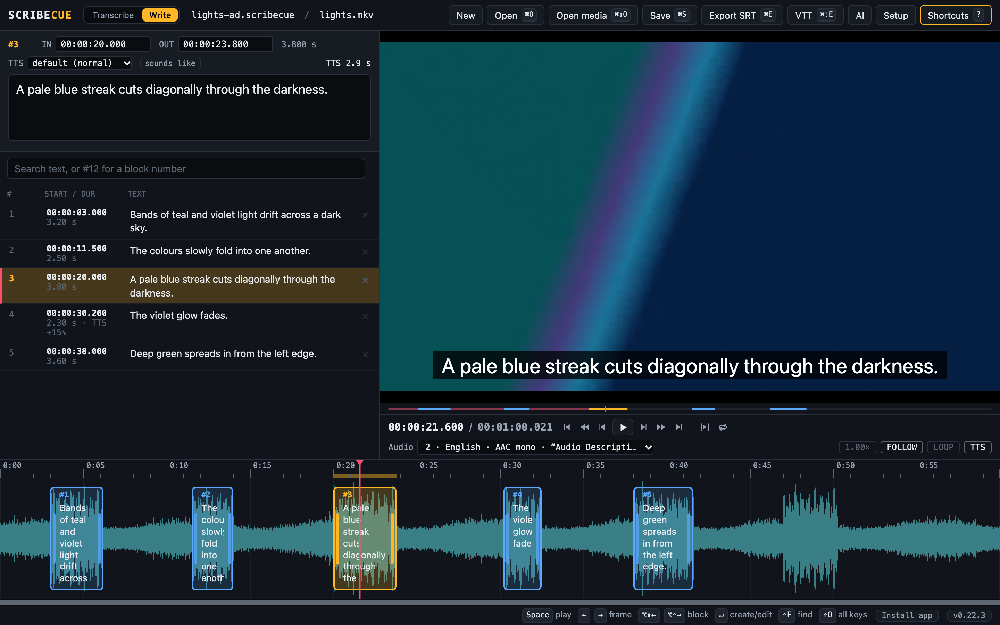
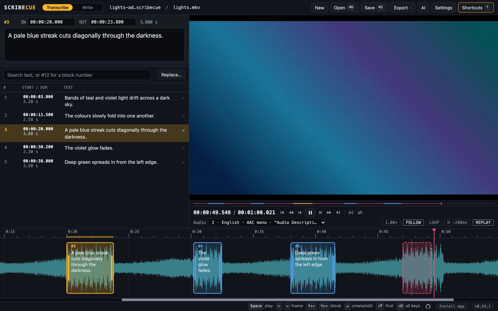
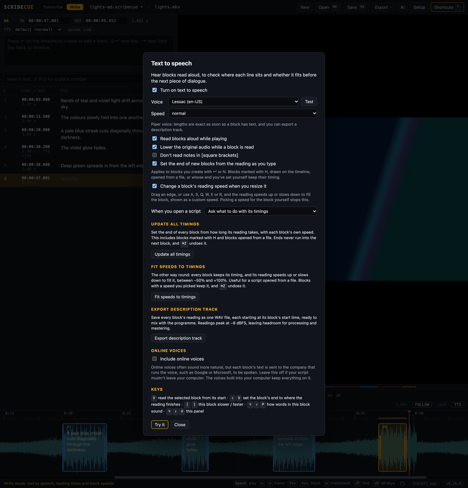
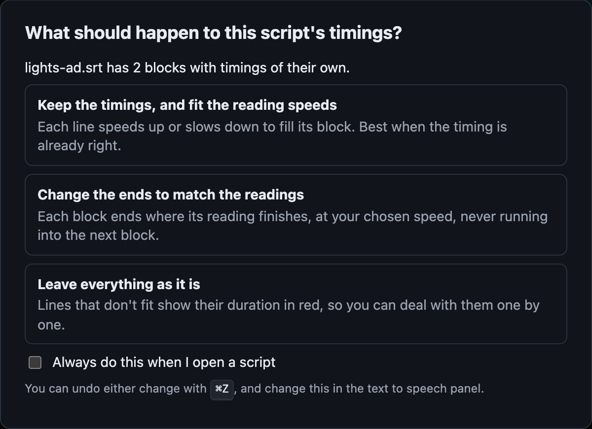
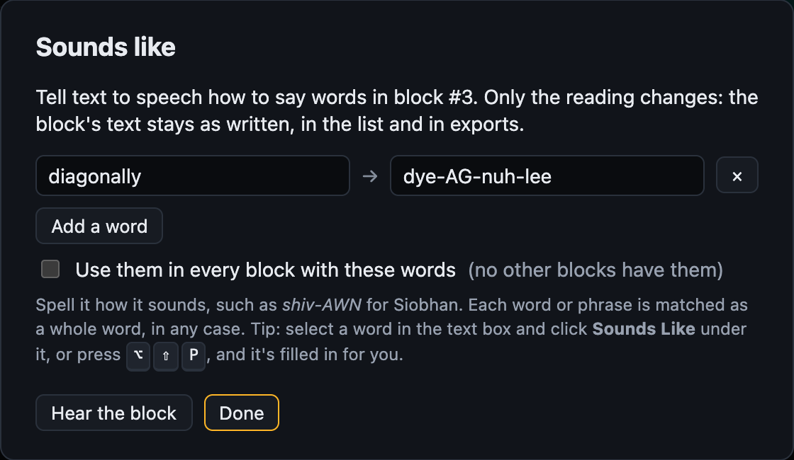
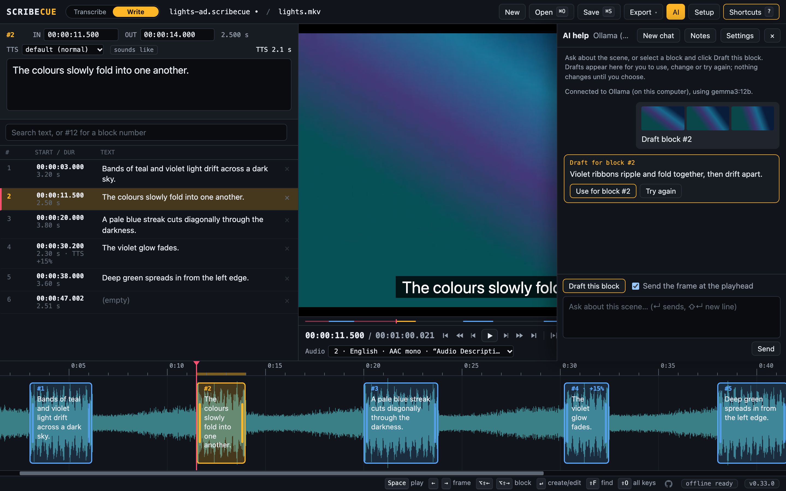
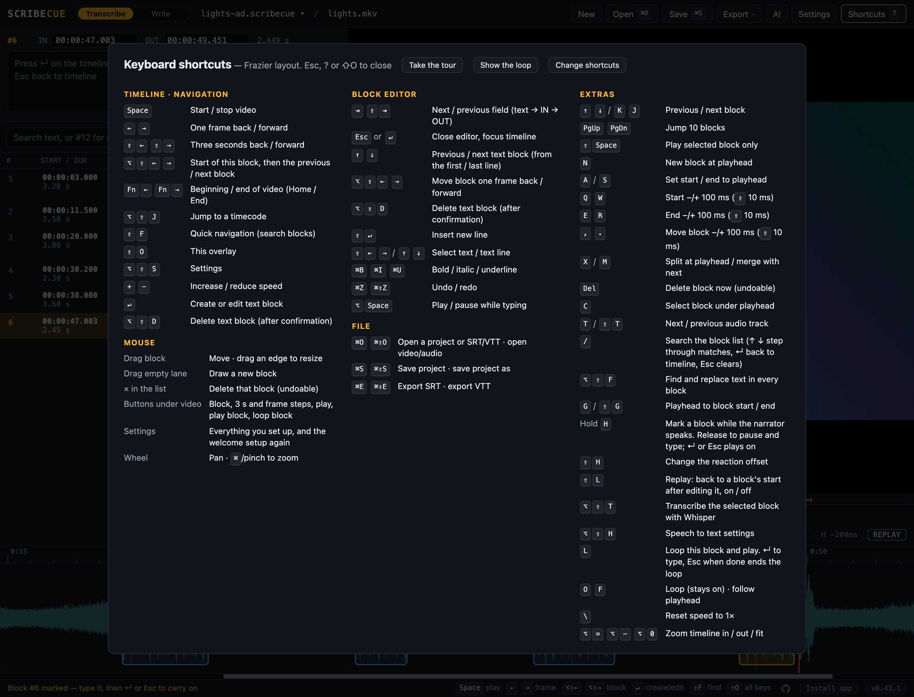

# Scribecue

**A keyboard-first editor for audio description scripts.**

- **Transcribe** existing audio description at its original timing: hold a key while the
  narrator speaks and a block appears.
- **Write** new audio description, with text to speech to hear each line and check it fits
  before the next piece of dialogue.
- Runs on your own computer in Docker. Your files are never uploaded.
- Uses the same keyboard layout as Frazier, so Frazier users don't need to relearn keys.
- Scripts open and save as SRT or WebVTT files.

## Quick start

### The easy way: use it in your browser

1. Open **<https://scribecue.kyleadvoice.ca/>** in Google Chrome or Microsoft Edge.
2. Optional: click **Install app** in the bottom right, or the install icon in the address
   bar. Scribecue then gets its own window and icon, like any other app, and works
   offline.

That's all. A one-minute guided tour shows you around first, then a short setup asks what
you're working on and turns on the tools for it. You can skip either.

Your video, audio and scripts are opened straight from your computer and never uploaded:
only the app itself is downloaded, the first time and when it updates. It updates itself,
usually without you noticing: a new version is used as you open Scribecue, and one that
arrives while you're working waits until you click **update ready** on the version number,
or open Scribecue again. [Piper voices](#piper-voices) work in the web version too:
download one from the text to speech panel.

The web version used to be at `kyle95wm.github.io/Scribecue`, which now forwards here.
Anything kept in the browser at the old address, such as unsaved work, settings and Piper
voices, stays with that address. If you installed or used it there, save your work as a
project file (`Ctrl/Cmd+S`) before switching, then open it here.

Scribecue is built for Chrome and Edge. Other browsers, such as Safari and Firefox, can
open it, but some features may not be available, and Scribecue tells you which.

### Or run it yourself

To keep everything, the app included, on your own computer, or to run Piper voices or
Ollama in containers next to it, run Scribecue with Docker. [INSTALL.md](INSTALL.md) walks
you through it, and covers updating and troubleshooting.

## Contents

- [Quick start](#quick-start)
- [Basic workflows](#basic-workflows)
  - [The writing loop](#the-writing-loop)
  - [The transcribing loop](#the-transcribing-loop)
  - [Saving](#saving)
  - [Getting around](#getting-around)
  - [Adjusting timing](#adjusting-timing)
- [Modes: Transcribe and Write](#modes-transcribe-and-write)
- [Transcribing audio description](#transcribing-audio-description)
  - [Hold-to-mark](#hold-to-mark)
  - [Looping a block](#looping-a-block)
  - [Text to speech](#text-to-speech)
  - [Piper voices](#piper-voices)
  - [AI help](#ai-help)
- [Files with several audio tracks](#files-with-several-audio-tracks)
- [Other handy features](#other-handy-features)
- [Keyboard shortcuts](#keyboard-shortcuts)
  - [Changing shortcuts](#changing-shortcuts)
  - [Keys on Mac, Windows and Linux](#keys-on-mac-windows-and-linux)
- [Supported files](#supported-files)
- [Privacy](#privacy)
- [Updating](#updating)
- [Running it yourself](INSTALL.md)
- [Development](#development)
- [Credits](#credits)
- [License](#license)

## Basic workflows

Most of the work is one short loop, repeated for every line. Learn the few keys in it and
you'll rarely need anything else. Press `?` at any time to see every shortcut.

### The writing loop

For new audio description, in **Write** mode with text to speech on (`Alt+Shift+V`, or
**Setup**). Open the video with `Ctrl/Cmd+Shift+O`, then repeat:

1. **Find a gap.** Play until there's room for a description, and stop there.
   - `Space` plays or pauses.
   - `←` `→` move one frame, to get the exact spot.
2. **Write the description.**
   - `Enter` makes a block at the playhead and opens it for typing.
   - Type the line. Its end follows how long the reading takes, and the reading time turns
     red if the line doesn't fit before the next block.
   - `Esc` closes the block.
3. **Listen to it.**
   - `V` reads the block aloud with the video.
   - `[` `]` make this block's reading slower or faster.

Then carry on playing to the next gap.

### The transcribing loop

For existing audio description, in **Transcribe** mode. Open the video with
`Ctrl/Cmd+Shift+O`. If it has a description track and you don't hear it, press `T` to
switch tracks. Then repeat:

1. **Play to the next line.**
   - `Space` plays or pauses.
2. **Mark it.**
   - Hold `H` while the narrator speaks, and let go when they stop. Playback pauses, and a
     block opens for typing.
3. **Type it.**
   - Type the line.
   - `Enter` or `Esc` closes the block, and playback carries on.

To hear a block again while you type, press `L`. It loops until you close the block.

### Saving

**Save your work as a project** with `Ctrl/Cmd+S`. A project (`.scribecue`) keeps
everything: the blocks, each block's text to speech speed and whether its end follows the
reading, the mode and its settings, where you were, and which video it belongs to. Keep
one per programme, and open any of them with `Ctrl/Cmd+O`.

- The first save asks where to put the file. After that, `Ctrl/Cmd+S` saves straight back
  to it, even after a reload. `Ctrl/Cmd+Shift+S` saves a copy under a new name.
- A dot after the project name at the top, such as `lights-ad.scribecue •`, means there
  are changes you haven't saved yet.
- Browsers can't remember where a video is, so after opening a project, open its video
  too. **Open** (`Ctrl/Cmd+O`) takes projects, scripts and video or audio files alike, and
  you can pick the project and its video together; `Ctrl/Cmd+Shift+O` opens only video or
  audio. Scribecue tells you which video a project belongs to, and warns you if you pick a
  different file.
- **New**, at the top left, starts again, and offers two ways to do it:
  - **Clear the blocks** removes every block and keeps the video, the project file and your
    notes, ready to write from scratch on the same video. To swap in a different script
    instead, you don't need this: opening a script (`Ctrl/Cmd+O`) replaces the blocks
    and keeps the video.
  - **New project** also closes the video and clears your notes, for different work.

  `Ctrl/Cmd+Z` brings the blocks back either way, though after a new project you'd open the
  video again.

Saving in place needs Chrome or Edge. Other browsers download a copy of the project each
time you save.

**Export** when the script is finished, or to hand it to someone who doesn't use
Scribecue, such as another writer or a QC reviewer. The **Export** menu at the top has:

- **Script as SRT** (`Ctrl/Cmd+E`).
- **Script as WebVTT** (`Ctrl/Cmd+Shift+E`), which also keeps each block's text to speech
  speed and sounds-like words.
- **Description track (WAV)**, in Write mode with a [Piper voice](#piper-voices): the
  readings as one audio file. It's also in the text to speech panel.

`Ctrl/Cmd+O` also opens SRT and VTT files. Your work in progress is saved in the browser
as you go too, so reloading the page doesn't lose anything.

### Getting around

| To | Press |
| --- | --- |
| Play or pause | `Space` |
| Move one frame back or forward | `←` `→` |
| Move 3 seconds back or forward | `Shift+←` `Shift+→` |
| Go back to the start of the block you're in, or on to the next one | `Alt+Shift+←` `Alt+Shift+→`. At a block's start, `Alt+Shift+←` goes to the previous block; while playing, pressing it twice quickly does the same |
| Step through the list | `↑` `↓`, from the selected block |
| Go to the start or end of the selected block | `G` / `Shift+G` |
| Go to the beginning or end of the video | `Home` / `End` (`Fn+←` / `Fn+→` on Mac laptops) |
| Go to a time | `Alt+Shift+J`, then type it, such as `1:23.5` |
| Go anywhere | Click the timeline, or drag along the time ruler above it |
| Jump around the whole video | Click or drag the scrubber bar under the video. It stays a thin line until you point at it. Blocks show as marks along it, the selected one highlighted, and hovering shows the time |

### Adjusting timing

| To | Press |
| --- | --- |
| Set the block's start or end to the playhead | `A` / `S` |
| Move the start or end by 100 ms | `Q` `W` / `E` `R` (with `Shift`: 10 ms) |
| Move the whole block by 100 ms | `,` `.` (with `Shift`: 10 ms) |
| Set the end to where the reading finishes (Write) | `Shift+V` |
| Drag a block, or its edges | Mouse, on the timeline |

## Modes: Transcribe and Write

The switch next to the Scribecue name picks what you're doing, and shows only the features
for it. Your choice is remembered. The setup that opens the first time you use Scribecue
asks this too, along with the tools for that mode and whether to check for updates.
**Setup** at the top runs it again. Nothing changes until you press **Finish**.

| | Transcribe | Write |
| --- | --- | --- |
| For | Existing audio description, at its original timing | New audio description |
| [Hold-to-mark](#hold-to-mark) (`H`, `Shift+H`) | ✓ | |
| [Text to speech](#text-to-speech) (`V`, `Shift+V`, `[` `]`, reading times, block speeds) | | ✓ |
| Everything else | ✓ | ✓ |

Switching only hides features. Block speeds and settings are kept for when you switch
back. Pressing a key from the other mode tells you which mode it's in.

## Transcribing audio description

### Hold-to-mark

In Transcribe mode:

1. Play the file with the description track selected.
2. **Hold `H`** while the narrator speaks a line. A dashed block grows on the timeline.
3. **Let go** when they stop. Playback pauses and the new block opens for typing.
4. Type the line and press `Enter` or `Esc`. Playback carries on.

Scribecue tidies up the timing for you:

| | What happens | Change it with |
| --- | --- | --- |
| **Reaction offset** | Both edges move back 200 ms, because your key press comes a moment after you hear the voice. | `Shift+H`, or click `H −200ms` under the video (0–300 ms) |
| **Starting from pause** | If you pause first and then hold `H`, the block starts exactly where you paused, with no offset. | |
| **No overlaps** | A new block is trimmed to fit the gap it starts in. | |

Your offset choice is remembered.

### Looping a block

Press `L`, or click the loop button under the video, to loop the block under the playhead
(or the selected block). Press `Enter` to type
while it repeats, then `Esc` when you're done, and the loop stops. Press `L` again to stop
it without editing.

For a loop that stays on until you turn it off, use `O` instead.

### Text to speech

Hear your lines read aloud, to check where each one sits and whether it fits before the
next piece of dialogue. It's part of Write mode, and off until you turn it on: press
`Alt+Shift+V`, or click `TTS` under the video, then tick **Turn on text to speech**.
**Test**, next to the voice, reads a short sample description so you can hear each voice.

| Key | Action |
| --- | --- |
| `V` | Read the block from its start, with the video playing. Playback stops at the block's end, or where the reading ends if it runs over |
| `Shift+V` | Read the block, then set its end to where the reading finishes |
| `[` `]` | Make the selected block's reading slower / faster |
| `Alt+Shift+V` | Choose the voice and speed |
| `Alt+Shift+P` | Sounds like: how words in this block are said |

- **Speed:** very slow (−30%), slow (−15%), normal, fast (+15%), very fast (+30%), and
  experimental +50% and +100%. The voice also follows the playback speed.
- **Speed per block:** set a block's own speed with `[` `]` or the **TTS** menu in the
  block editor. Blocks with their own speed show it in the list and on the timeline, such
  as `+15%`. The rest follow the overall speed. Setting a block back to the overall speed
  makes it follow that again. Block speeds are saved with your work and in exported VTT
  files, as notes that other programs ignore. SRT files can't store them.
- **Read blocks aloud while playing:** each block is read as the playhead reaches it,
  with the original audio turned down. You can turn either part off.
- **Opening a script:** when you open an SRT or VTT script in Write mode with text to
  speech on, Scribecue asks what to do with its timings: keep them and fit the reading
  speeds, change the ends to match the readings, or leave everything as it is. Tick
  **Always do this** to stop it asking, and change your choice later under **When you open
  a script** in the text to speech panel. Either change can be undone. Opening a Scribecue
  project doesn't ask.

  
- **Fit speeds to timings:** the opposite of Update all timings, for a script whose
  timing is already right, such as one opened from a file. Every block keeps its timing,
  and its reading speeds up or slows down to fill it, within −50% to +100%. Blocks with a
  speed you picked keep it. It asks first, and `Ctrl/Cmd+Z` undoes it. With a Piper voice
  the fit is exact. The blocks then keep fitting as you edit their text or resize them.
- **Resizing changes the speed:** in Write mode, change a block's length by dragging an
  edge, with `A` `S` `Q` `W` `E` `R`, or by typing in IN or OUT, and its reading speeds up or
  slows down to fill the new length. The block's speed then shows as custom, such as
  `custom (−12%)`, and keeps fitting as you edit the text. It stays between −50% and
  +100%. Picking a speed for the block yourself, from its menu or with `[` `]`, keeps that
  speed when you resize; setting it back to default lets resizing fit it again. Turn this
  off with **Change a block's reading speed when you resize it** in the text to speech
  panel.
- **Sounds like:** when a voice says a name or word wrong, tell it how to say it, without
  changing the text. Select the word in the text box and press `Alt+Shift+P` (or click
  **sounds like** next to the block's speed), then spell it how it sounds, such as
  *shiv-AWN* for Siobhan, and click **Hear the block** to check. Each block keeps its own
  list. Words are matched whole and in any case, so the reading, its length and the
  exported description track all use the new sound, while the list, SRT exports and the
  timeline show the words as written. Projects and VTT exports keep the list, as notes
  other programs ignore. `Ctrl/Cmd+Z` undoes a change.

  
- **Notes in [square brackets]:** if your team writes notes in the script inside square
  brackets, such as `[Wide shot, hold for the door]`, tick **Don't read notes in [square
  brackets]** in the text to speech panel. They're then left out of every reading, reading
  time and auto end, and out of the exported description track, but stay in the script and
  in SRT and VTT exports.
- **Ends set from the reading:** while text to speech is on, a new block made with `Enter` or
  `N` takes its end from how long the reading takes, and keeps following it as you type
  or change the speed. An `auto` tag next to OUT shows this. It never runs into the next
  block. Once you set the end yourself, by dragging, `S`, `E` / `R` or typing in OUT,
  the block keeps it. Blocks marked with `H`, drawn on the timeline or opened from a file
  are never changed. You can turn this off in the text to speech panel.
- **Update all timings:** a button in the text to speech panel sets the end of every block
  with text from its reading, using each block's own speed. It asks first, because it also
  changes blocks marked with `H` or opened from a file, and `Ctrl/Cmd+Z` undoes it. Ends never run
  into the next block. With a [Piper voice](#piper-voices) the lengths are always exact.
  With a browser voice, tick **Read each block silently first** for exact lengths. That
  takes about as long as reading them all, shows its progress, and can be stopped.
- **Timing check:** the editor shows how long the reading takes, such as `TTS 2.9 s`, in red
  if it's longer than the block, and the list shows that block's duration in red. `~`
  means it's an estimate. It becomes exact once the
  block has been read, and the estimates get more accurate for a voice as you use it.

Scribecue uses the voices built into your computer, so the text stays on it. For much more
natural voices that also stay on your computer, [use Piper](#piper-voices). Mac and
Windows come with several built-in voices. On Linux, browsers read through speech-dispatcher, so you may
need to install it with a voice such as espeak-ng from your distribution's packages.

**Online voices** are a separate opt-in in the same panel. They often sound more natural,
but each block's text is sent to the company that runs the voice, such as Google or
Microsoft, to be spoken. Leave them off if your script mustn't leave your computer.
They come from the browser, so which ones you get depends on where you open Scribecue:
Microsoft Edge has dozens, Chrome has a few Google voices, and Safari and Firefox have
none. They only work while you're online.

To add more voices that stay on your computer, then reload Scribecue:

- **Mac:** System Settings → Accessibility → Spoken Content, click ⓘ next to **System
  voice**, and download an "Enhanced" or "Premium" voice.
- **Windows:** Settings → Time & language → Speech, then **Add voices**.
- **Linux:** install more speech-dispatcher voices from your distribution's packages.

Not every browser lists every installed voice.

The browser's own voices can only be heard, not recorded. To export the readings as an
audio file, use a [Piper voice](#piper-voices).

### Piper voices

[Piper](https://github.com/OHF-Voice/piper1-gpl) is an open-source speech engine with
natural-sounding voices, and it's the one we recommend for audio description work. The
voices run on your computer, so your script never leaves it, and they work offline. In the [web version](#in-the-web-version) Piper runs in your
browser; [with Docker](#with-docker) it runs in a second container, next to the editor.

With a Piper voice:

- **Lengths are exact straight away.** The editor's `TTS` time, the red durations, block
  ends set from the reading and **Update all timings** all use the real reading, with no
  silent read-through.
- **Each line always takes the same time,** so the timing you see is the timing you get,
  between sessions and in the export.
- **You can export a description track.** **Export description track** in the text to
  speech panel saves every block's reading as one WAV file, each starting at its block's
  start, as long as the video. It's ready to mix with the programme. Every reading peaks at
  −8 dBFS, so blocks are evenly matched and there's headroom for processing and mastering;
  readings that run into the next block overlap in the file, never taking it past −6 dBFS,
  and the panel tells you how many there are.

Four English voices are offered: Lessac and Ryan (US), and Alba and Alan (UK).

#### In the web version

Setup offers one: in its text to speech step, tick **Download a natural-sounding Piper
voice** and pick a voice, and it downloads in the background when you finish. Or, any
time in Write mode, open the text to speech panel (`Alt+Shift+V`, or `TTS` under the
video), turn text to speech on, and under **Natural voices** pick a voice and click
**Download**. Each voice is about 63 MB. The first one also brings the speech engine,
about 33 MB, which all the voices share.
Once it's downloaded, the voice is chosen for you and works offline. The files come from
Scribecue's own site and stay in your browser; to free the space, pick the voice and click
**Remove**.

Readings take a moment longer than with Docker, as they run in the browser, but they're
the same length to the hundredth of a second.

#### With Docker

Running Scribecue yourself, Piper can run in a container next to it instead, with four
English voices built in and others you choose. See
[Natural-sounding voices](INSTALL.md#natural-sounding-voices-piper) in INSTALL.md.

### AI help

Scribecue can use your own AI provider to help describe what's on screen. Click **AI** at
the top, or press `Alt+Shift+A`, and a drawer slides out beside the video:

- **Draft this block:** select a block and click it. Scribecue sends stills from the block,
  the script around it and how many words fit, worked out from the block's length and the
  voice's speed. The draft appears in the drawer: click **Use for block #n** to put it in the
  block (`Ctrl/Cmd+Z` undoes it), or **Try again**. Nothing changes until you choose.
- **Chat:** ask about the scene, such as "who's in the background?". With **Send the frame at
  the playhead** ticked, it sees the frame you're on, along with the selected block and the
  script around it.

- **Project notes:** click **Notes** in the drawer to tell the AI what the frames can't
  show: who the characters are and how to tell them apart, where and when it's set, and
  your team's style, such as "Name characters once they've been introduced". Every draft
  and message includes them, and they're saved with the project. **Notes ✓** means there
  are some.

Drafts are only as good as the model. Small models that run on a laptop, such as
`gemma3:4b`, often misread a scene; a bigger one, such as `gemma3:12b`, or an online model
does much better. Project notes, more frames per draft, and correcting a draft in the chat
before **Try again** all help too.

Connect a provider in the drawer's **Settings**:

| Provider | How to connect |
| --- | --- |
| **Claude** (Anthropic), **OpenAI**, **Gemini** (Google) | Paste an API key from the provider's site. Usage is billed by the provider, separately from any ChatGPT, Claude or Gemini subscription. |
| **OpenRouter** | Click **Sign in with OpenRouter**: one account for models from OpenAI, Anthropic, Google and more, paid with OpenRouter credit. Or paste an OpenRouter key. |
| **Ollama** | Runs the model on your own computer, so nothing leaves it. Install [Ollama](https://ollama.com) and pull a model that can see images, such as `gemma3` or `llava`. For the web version, start Ollama with `OLLAMA_ORIGINS=https://scribecue.kyleadvoice.ca` so the page can reach it; with Docker, nothing extra is needed. Or run it [in Docker, next to Scribecue](INSTALL.md#ollama-in-docker). |

Then pick a model (**Load models** lists the provider's), and how many frames a draft
sends. Keys stay in your browser, either remembered on this computer or kept for this tab
only, and are only ever sent to their own provider.

When you send a message or ask for a draft, the frames and the nearby blocks go to the
provider you chose, under its terms. Don't use an online provider for programmes you
mustn't share; Ollama keeps everything on your computer.

## Files with several audio tracks

When a file has more than one audio track, such as the original mix and an audio
description mix, an **Audio** picker appears under the video. Press `T` / `Shift+T` to switch
tracks. The waveform always shows the track you're hearing.

A track marked as audio description is picked automatically. Scribecue looks for
Matroska's visually-impaired flag, an MP4 `kind` box, or a name containing "description",
"AD" or "narration".

How track switching works

Chrome and Firefox can only play a video's default audio track. So Scribecue copies the
chosen track out, without re-encoding, into an audio-only file in memory, and plays it in
step with the muted video. Each track is copied once per session, so switching back
afterwards is instant. Safari switches tracks itself.

## Other handy features

- **Search:** the box above the list filters blocks by text, or by number with `#12`.
  Press `/` to jump to it. `Shift+F` opens quick navigation, and `Alt+Shift+J` jumps to a timecode.
- **Player controls:** the buttons under the video step to the previous or next block,
  jump 3 seconds or one frame, play or pause, play just the selected block, and loop the
  block under the playhead. Hover over one to see its key.
- **Copy a timecode:** click the clock under the video. To set a block's start or end to
  the playhead, press `A` or `S`.
- **Mouse:** drag a block to move it, drag an edge to resize it, or drag across empty
  space to draw a new block. Scroll to pan, and `Ctrl/Cmd`+scroll or pinch to zoom.
- **Guided tour:** lights up each part of the editor in turn and explains it, from the two
  modes to text to speech, AI help and privacy, then shows the loop to work in for your
  mode (see [Basic workflows](#basic-workflows)). It opens on your first visit, before the
  setup, and **Take the tour** in the shortcuts overlay (`?`) shows it again. `→` and `←` step through it, and
  `Esc` ends it.
- **What's new:** after Scribecue updates, a window lists everything that changed since the
  version you were on. In the web version, click the version number in the bottom right to
  see the current release's notes again.
- **Scribecue on GitHub:** the small GitHub mark in the bottom right opens the project's
  page, with the source, releases and a place to report problems.

## Keyboard shortcuts

The layout follows the
[Frazier cheat sheet](https://www.videotovoice.com/docs/en/cheatsheet/mac.html).
See [Keys on Mac, Windows and Linux](#keys-on-mac-windows-and-linux) for how the modifier
keys are named on each system. The tables below are the usual keys.

### Changing shortcuts

Press `?` and click **Change shortcuts** to give any action the keys you like:

- Click **Add** next to an action, then press the keys. If they already belong to another
  action, Scribecue says which and asks before moving them. Click a key to take it off,
  and **Reset** puts an action back to its usual keys. **Find** narrows the list.
- **Export** saves your shortcuts as `scribecue-shortcuts.json`, and **Import** loads one,
  so a team can share a layout. **Reset all** goes back to the usual keys.
- The shortcuts overlay and the player buttons' tooltips show your keys.

Most actions can be changed. Keys with `Ctrl/Cmd` (undo, open, save, export), keys used
while typing in a box, and `?` `/` `[` `]` `+` `−` `Esc` stay as they are, because they go
by the character on the key and so suit every keyboard layout. Your shortcuts are kept in
this browser.

<strong>Timeline</strong>

| Key | Action |
| --- | --- |
| `Space` | Play / pause |
| `←` `→` | One frame back / forward |
| `Shift+←` `Shift+→` | Three seconds back / forward |
| `Alt+Shift+←` `Alt+Shift+→` | Start of the block you're in, then the previous block / the next block, from the playhead |
| `Home` `End` | Beginning / end of the video (`Fn+←` `Fn+→` on Mac laptops) |
| `Alt+Shift+J` | Jump to a timecode (`hh:mm:ss.mmm`, `hh:mm:ss:ff`, `mm:ss` or seconds) |
| `Shift+F` | Quick navigation: find a block by text or number |
| `+` `-` | Faster / slower playback |
| `Enter` | Create or edit a block |
| `Alt+Shift+D` | Delete a block (asks first) |
| `Shift+O` or `?` | Show all shortcuts |

<strong>Block editor</strong>

| Key | Action |
| --- | --- |
| `Tab` `Shift+Tab` | Next / previous field (text → IN → OUT) |
| `Esc` or `Enter` | Close the editor |
| `Shift+Enter` | New line |
| `↑` `↓` | Previous / next block (from the first / last line) |
| `Alt+Shift+←` `Alt+Shift+→` | Move the block one frame back / forward |
| `Alt+Space` | Play / pause while typing |
| `Ctrl/Cmd+B` `Ctrl/Cmd+I` `Ctrl/Cmd+U` | Bold / italic / underline |
| `Ctrl/Cmd+Z` `Ctrl/Cmd+Shift+Z` | Undo / redo |
| `Ctrl/Cmd+S` / `Ctrl/Cmd+Shift+S` | Save the project / save it as a new file |
| `Ctrl/Cmd+E` / `Ctrl/Cmd+Shift+E` | Export SRT / WebVTT |
| `Ctrl/Cmd+O` / `Ctrl/Cmd+Shift+O` | Open a project or script / open a video or audio file |

<strong>Extras</strong> (on keys Frazier leaves free)

| Key | Action |
| --- | --- |
| Hold `H` | [Hold-to-mark](#hold-to-mark) a block while the narrator speaks |
| `Shift+H` | Change the hold-to-mark reaction offset |
| `L` | [Loop this block](#looping-a-block) until you finish editing it |
| `N` | New block at the playhead |
| `A` / `S` | Set start / end to the playhead |
| `Q` `W` | Start −/+ 100 ms (with `Shift`: 10 ms) |
| `E` `R` | End −/+ 100 ms (with `Shift`: 10 ms) |
| `,` `.` | Move the block −/+ 100 ms (with `Shift`: 10 ms) |
| `X` / `M` | Split at the playhead / merge with the next block |
| `Del` | Delete the block straight away (undo with `Ctrl/Cmd+Z`). The × at the end of each row in the list does the same for that block |
| `↑` `↓` or `K` `J` | Previous / next block |
| `PgUp` `PgDn` | Jump 10 blocks |
| `G` / `Shift+G` | Playhead to the block's start / end |
| `C` | Select the block under the playhead |
| `Shift+Space` | Play just the selected block |
| `T` / `Shift+T` | Next / previous audio track |
| `/` | Search the block list |
| `O` | Loop on / off |
| `F` | Follow the playhead on / off |
| `V` / `Shift+V` | [Read the block aloud](#text-to-speech) / fit the block to the reading |
| `[` `]` | Make the block's reading slower / faster |
| `Alt+Shift+V` | Text to speech settings |
| `Alt+Shift+P` | [Sounds like](#text-to-speech) for the selected block |
| `Alt+Shift+A` | Open or close [AI help](#ai-help) |
| `Alt+=` `Alt+-` `Alt+0` | Zoom the timeline in / out / to fit |
| `\` | Reset speed to 1× |

### Keys on Mac, Windows and Linux

The keys are in the same places on every system. `Ctrl/Cmd` means `Ctrl` on Windows and
Linux and `Cmd` (⌘) on a Mac. `Alt` is `Option` (⌥) on a Mac. Scribecue shows the right
names for your system in the app.

One key differs, to avoid a clash with the system: **play / pause while typing** is
`Alt+Space` on a Mac and `Ctrl+Space` on Windows and Linux, because Windows keeps
`Alt+Space` for the window menu.

If `Alt+Shift` switches your keyboard layout on Windows, the block shortcuts also have
other keys: `↑` `↓` or `K` `J` for previous / next block, and `Del` to delete. You can also
drop a media file on the window instead of pressing `Ctrl+Shift+O`.

Frazier features that Scribecue doesn't have aren't included: glossaries, snippets,
markers, comments, pronunciation, extended audio description, and instruction or pause
marks. Their keys show a short notice instead.

## Supported files

| | Supported |
| --- | --- |
| **Projects** | Scribecue projects (`.scribecue`), to open and save |
| **Scripts** | SRT and WebVTT, to open and to export |
| **Video and audio** | MP4, MOV, M4A, MKV, WebM and WAV, with AAC, Opus, Vorbis, FLAC, MP3 or PCM audio |
| **Very large files** | Fine: the waveform is built by streaming the file from disk, and fills in as it goes |
| **Other formats** | The whole file is decoded in memory, so they need to be under 2 GB |
| **AC-3, E-AC-3, DTS, TrueHD** | Play, but with no waveform, because browsers can't decode them |

When switching audio tracks, Vorbis tracks show a waveform but can't be played on their own.

## Privacy

- Video, audio and script files are opened straight from your disk and never uploaded.
- The [web version](#the-easy-way-use-it-in-your-browser) downloads the app itself from
  GitHub Pages, the first time and when it updates, so GitHub sees those requests. After
  that it works offline. Run it yourself with Docker to keep even that on your computer.
- The server only hands out the app's own files, and only to your own computer
  (`127.0.0.1`).
- A strict security policy stops the page from contacting any other site. The exceptions
  are the [update check](#updating), which only runs if you agree to it, and the AI
  providers below, which are only contacted once you connect one.
- [Text to speech](#text-to-speech) uses the voices on your computer. Online voices, which
  send the text to their provider, are only offered if you turn them on.
- [AI help](#ai-help) is off until you connect a provider. Then, only when you send a
  message or ask for a draft, frames and nearby blocks go to the provider you chose, or
  stay on your computer with Ollama. The security policy allows those providers' addresses
  and nothing else.
- [Piper](#piper-voices), if you add it, runs in its own container with no internet access
  and no port of its own. The page reaches it through Scribecue's server. In the web
  version, Piper voices you download come from Scribecue's own site and run in your
  browser.

## Updating

**The web version** updates itself as you open it. An update that arrives while you're
working waits until you click **update ready** on the version number, or open Scribecue
again.

**Running it yourself with Docker:** see [Updating](INSTALL.md#updating) in INSTALL.md.

## Development

The app is plain HTML, CSS and JavaScript with no build step. How to run it, the checks
to run before committing, and how releases work are in [INSTALL.md](INSTALL.md#development).

## Credits

The keyboard layout is modelled on [Frazier](https://www.videotovoice.com/) by
videotovoice, an audio description tool, so writers who already know Frazier can switch
between the two without relearning keys. Thanks to the Frazier team for publishing their
shortcut cheat sheet.

The optional [Piper voices](#piper-voices) use [Piper](https://github.com/OHF-Voice/piper1-gpl)
by the Open Home Foundation, which is licensed under the GPL and downloaded when you build
its container. The web version runs Piper's voices with
[ONNX Runtime Web](https://github.com/microsoft/onnxruntime) by Microsoft (MIT) and
[piper-wasm](https://github.com/diffusion-studio/piper-wasm), the
[espeak-ng](https://github.com/espeak-ng/espeak-ng) build used by Piper (GPL), downloaded
only when you choose a voice. Each voice has its own licence, listed on its
[voice page](https://huggingface.co/rhasspy/piper-voices).

Scribecue is an independent project. It is not affiliated with, endorsed by or connected
to Frazier or videotovoice. Frazier is their product name, used here only to describe the
keyboard layout.

## License

[MIT](LICENSE)
